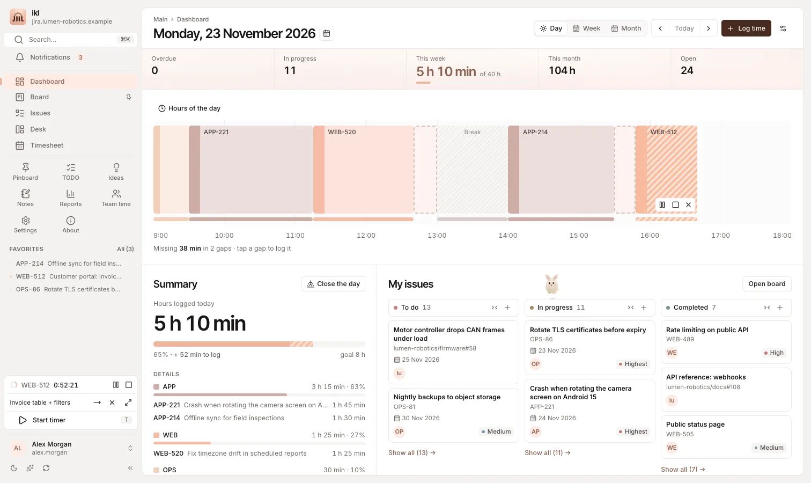
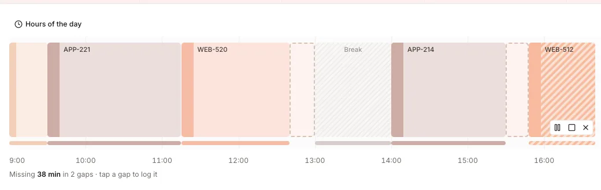
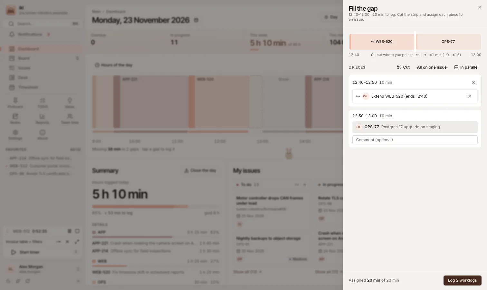
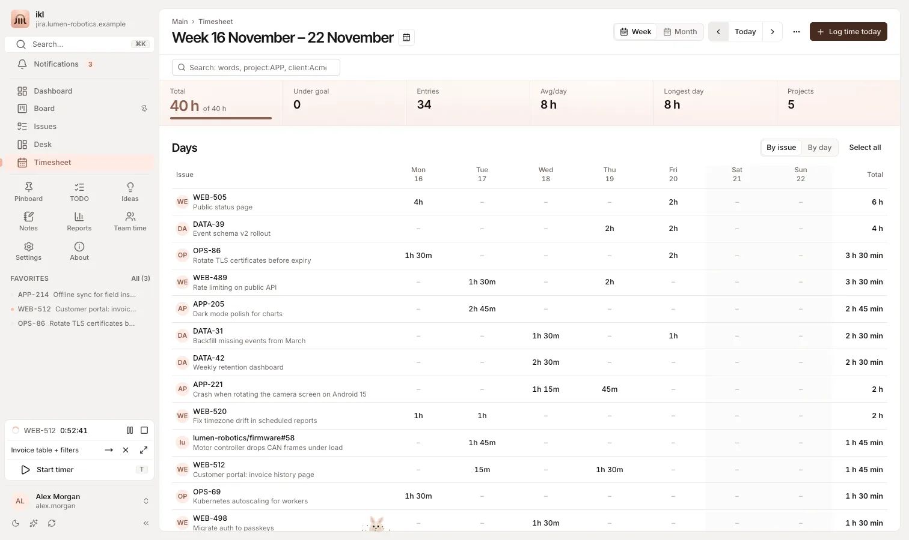
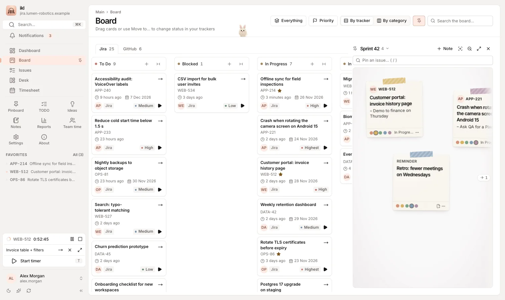
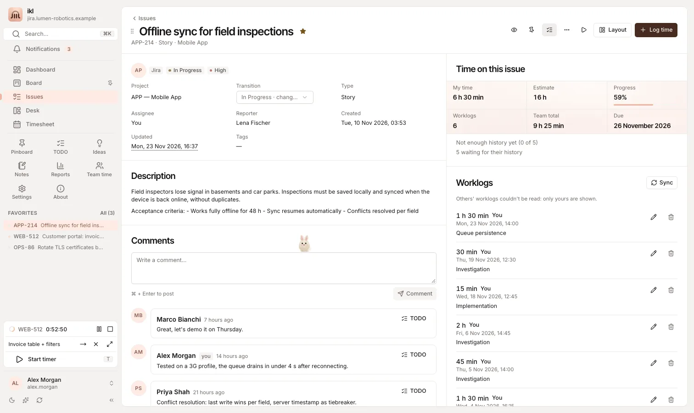
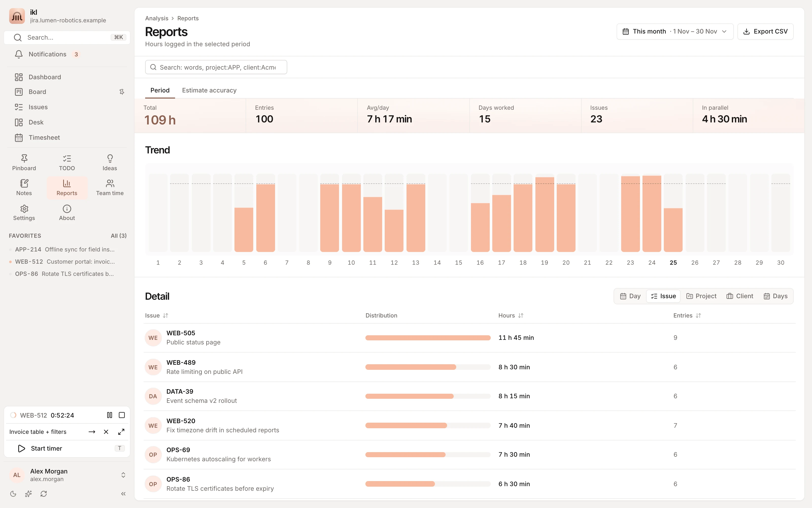

<p align="center">
  <picture>
    <source media="(prefers-color-scheme: dark)" srcset="docs/brand/logo-dark.svg">
    
  </picture>
</p>

<h1 align="center">inkledger</h1>

<p align="center"><b>Your time, from every tracker, in one ledger you host yourself.</b></p>

<p align="center">
  <a href="LICENSE"></a>
  
</p>

<p align="center">
  <!-- docs/media/hero.webp: see docs/media/SHOTLIST.md -->
  
</p>

## What it is

inkledger is a self-hosted time tracker for the issues you already have. It keeps your issues from Jira (Cloud, Server and Data Center), GitHub, GitLab and other trackers in one local catalogue, runs your timers, shows the holes in your working day and lets you fill them in seconds.

Where a tracker keeps time, as Jira does, inkledger writes real worklogs, once, even when the tracker is down. Where it does not, as on GitHub, the time stays in inkledger's own register. It runs on your machine, with your tracker credentials sealed on the server.

## Who it is for

- People who log time on Jira (or another tracker) every day and want it to take seconds, not a Friday afternoon.
- People whose work is spread over more than one tracker.
- Small teams who want to keep their time data on their own server: each person connects their own trackers.

## Features

- **Day timeline**: the working day with logged time, running timers and the gaps still to fill; cut a gap into pieces and assign each to an issue.
- **Timers and quick log**: live timers, familiar syntax (`2h 30m`, `1d`), idle detection, an end-of-day review.
- **Timesheet and reports**: week and month views, close a week, any date range grouped by day, issue, project or client, CSV export.
- **Board**: per tracker with its own workflow, by category or with your own columns, plus a pinboard of post-its.
- **Private notes**: dated notes on any issue, kept in inkledger and never sent to the tracker.
- **Search**: one query language for every tracker, also sent to the trackers themselves.
- **Trackers**: Jira, GitHub and GitLab are verified on real accounts; eighteen more trackers and five time trackers (Tempo, Harvest, Clockify, Toggl Track, Everhour) are built against simulators and only read until you allow writes. See the [capability matrix](api/providers/CATALOG.md).
- **Offline queue**: worklogs wait while a tracker is unreachable and are replayed without duplicates.
- **Backups, accounts, devices**: scheduled Postgres backups with restore, local accounts with invitations, native apps (Tauri) for macOS, Windows and Android, an installable web app for iPhone.
- **English and Italian**, light and dark themes, a ⌘K command palette and keyboard alternatives to every drag and drop.
- **Mods**: optional add-on modules from the in-app Store (see [below](#add-on-modules)).

## Screenshots

All data shown is fictional. The captures are listed in [docs/media/SHOTLIST.md](docs/media/SHOTLIST.md).

| | |
| --- | --- |
|  |  |
| **Day timeline** with a running timer | **Fill the gap**: cut a hole, assign the pieces |
|  |  |
| **Timesheet**: the week at a glance | **Board** with the pinboard |
|  |  |
| **Issue details** with worklogs and time totals | **Reports** by day, issue, project or client |

<p align="center">
  <!-- docs/media/clip-fill-the-gap.mp4: see docs/media/SHOTLIST.md -->
  <a href="docs/media/clip-fill-the-gap.mp4">Clip: filling a gap in the day (19 s)</a>
</p>

## Quick start (Docker)

You need Docker with Compose. The app listens on `http://127.0.0.1:47823` (loopback only), with Postgres 17 beside it.

```bash
git clone https://github.com/inkledger/inkledger.git
cd inkledger

# One-time secrets (the file is gitignored)
PG=$(openssl rand -hex 16)
cat > .env.docker <<EOF
POSTGRES_PASSWORD=$PG
DATABASE_URL=postgres://inkledger:$PG@db:5432/inkledger
SESSION_SECRET=$(openssl rand -hex 32)
# Seals your trackers' credentials; keep it with your backups
CREDENTIALS_KEY=$(openssl rand -hex 32)
EOF

docker compose pull        # or: docker compose build, to build from source
docker compose up -d
curl http://127.0.0.1:47823/api/health    # {"status":"ok"}
```

Open http://127.0.0.1:47823 and sign in as **admin**. The first password is `INKLEDGER_ADMIN_PASSWORD` if you set one; otherwise read it with `docker exec inkledger cat /app/data/initial-admin-password`. You choose a new one at the first sign-in. Then connect your trackers in **Settings → Connections** and invite others from **Settings → Users**.

Migrations run at start. Backups are scheduled from **Settings → Backup** and land in `~/Backups/inkledger` (`INKLEDGER_BACKUP_DIR` changes it).

HTTPS, updates, configuration variables and development setup are in [docs/self-hosting.md](docs/self-hosting.md); every variable is also described in [.env.example](.env.example).

## Add-on modules

Mods are small, signed packages that add something on top of the app (a desk bunny, a lo-fi radio, a cross-stitch hoop that fills with your week) without touching your data. Each has its own switch, and one switch turns them all off on a device.

**Sandbox.** Framed modules run in a sandboxed iframe with an opaque origin: no access to the app's cookies, storage or DOM, no network (`connect-src 'none'`), and only the capabilities their signed manifest declares, through a message broker with a watchdog. Modules built for the older in-page API still run in the page.

**Store and licences.** Optional modules are available through the in-app Store (Settings → Store), under the [module terms](docs/modules-terms.md). Kanbunny is a test mod for exploring the page in a different way and sharing feedback. The Store is the only outbound call besides your trackers and optional weather; `STORE_URL=off` turns it off.

## Security and privacy

- Self-hosted, no telemetry.
- Tracker secrets are sealed with AES-256-GCM and used only server-to-tracker.
- Trackers not verified on a real account only read until you allow writes; `PROVIDERS_READ_ONLY=1` refuses every write.

More in [docs/self-hosting.md](docs/self-hosting.md#security-and-privacy). Report vulnerabilities privately: [SECURITY.md](SECURITY.md).

## Contributing

Issues and pull requests are welcome. [CONTRIBUTING.md](CONTRIBUTING.md) has the setup, the test commands and the conventions. Before opening a PR, run:

```bash
pnpm lint && pnpm check && pnpm test && pnpm build && pnpm test:smoke && PROVIDERS_READ_ONLY=1 pnpm test:e2e
```

The end-to-end tests need Postgres and Chromium. A fixed interaction bug comes with a test in `e2e/`.

## License

[MIT](LICENSE).
