<p align="center">
  <picture>
    <source media="(prefers-color-scheme: dark)" srcset="docs/brand/logo-dark.svg">
    
  </picture>
</p>

<h1 align="center">inkledger</h1>

<p align="center"><i>Your time, from every tracker, in order.</i></p>

<p align="center">
  <b>A self-hosted, keyboard-first ledger for your time across Jira, GitHub, GitLab, Linear and 20 more trackers.</b><br/>
  Timers, gap filling, an offline-safe queue and native apps. Time goes where the tracker keeps it, and stays yours.
</p>

<p align="center">
  <a href="LICENSE"></a>
  
  <a href="docs/case-study.pdf"></a>
</p>

<p align="center">
  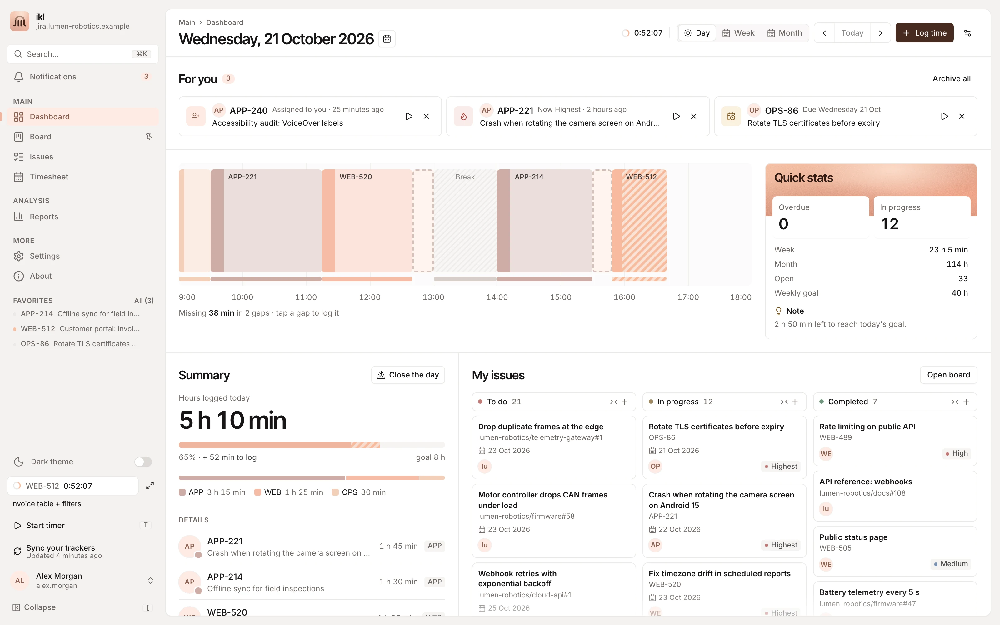
</p>

## Why

Logging time is slow: open the issue, find the dialog, type `1h 30m`, guess when you started. Then you forget an afternoon and rebuild it on Friday. And if your work lives in more than one tracker, you do it twice.

inkledger keeps your issues, from every tracker you use, in one fast local catalogue. It runs your timers, shows the holes in your working day and lets you fill them in seconds. Where a tracker keeps time, as Jira does, it writes real worklogs, never twice, even when the tracker is down. Where it does not, as on GitHub, the time stays in inkledger's own register. It runs on your machine, with your credentials encrypted.

Each person connects their own trackers; none is "the base". Jira (Cloud, Server and Data Center, localized installs included) and GitHub are verified on real accounts. Eighteen more trackers and five time trackers are built against simulators written from their documentation: they read as soon as they are connected, and write only once you allow it, connection by connection, until they are verified too.

📄 **Read the [case study (PDF)](docs/case-study.pdf)**: the problem, the design decisions and how it is built.

## Features

**Trackers**
- **One provider contract** for every tracker: adapters, a shared conformance suite and a [capability matrix](api/providers/CATALOG.md) of 25 services
- **Verified on real accounts**: **Jira** (Cloud, Server and Data Center), **GitHub** and **GitLab** (gitlab.com and self-hosted)
- **Built on simulators, not verified yet** ("Not verified" in Settings, writes off until you allow them): Gitea and Forgejo, Linear, YouTrack, Azure DevOps, Shortcut, Plane, OpenProject, Redmine, Trello, Asana, ClickUp, monday.com, Notion, Wrike, Basecamp, Todoist and Microsoft Planner. Self-hosted servers may be on your own network or tailnet
- **Time trackers beside your trackers**: Harvest, Clockify, Toggl Track and Everhour get every worklog too, filed under the project you map; **Tempo** takes the place of its Jira: new time goes to Tempo, which writes it to Jira, one worklog and never two
- **GitHub** signs in with a code on github.com (OAuth device flow), supports several accounts and brings every issue of the repositories you own, collaborate on, belong to through an organisation or watch; any repository can be left out
- **Several connections per type**: test, rename, reconnect or archive them (the time stays)
- **Clients**: group projects and repositories by who pays for them, with hours per client in the Timesheet and Reports
- **Buckets**: per-device views that narrow lists, board, palette, Timesheet and Reports to chosen trackers, projects or repositories, with "Everything" one click away; filling the gaps of your day always counts all your time
- **Webhooks** (optional): a tracker that can reach your server tells it at once when something changes
- **No surprise sign-outs**: a rejected tracker credential marks that connection "reconnect" instead of logging you out

**Track**
- **Live timers** with a badge in the header and the window title; switching issue can stop the previous one and ask to log it
- **Fill the gaps**: the day timeline marks unlogged holes of your working schedule; cut a hole into pieces and assign each to an issue
- **Quick log** with familiar syntax (`2h 30m`, `1d`, `45m`) and presets
- **Overlaps are allowed**, for parallel work and AI agents: a per-user policy warns or blocks, and the day timeline shows overlapping work in lanes
- **Idle detection**, **focus mode** and an **end-of-day review** that turns stopped timers into worklogs in one go
- **Where time goes**: trackers that keep time (Jira, GitLab, YouTrack, Redmine…) are written through, and time logged on them directly comes back; trackers without worklogs (GitHub, Linear…) keep time in inkledger's own register. A worklog changed on both sides waits for you to pick; one the tracker locked (an approved period) stays read-only. Deleted worklogs wait 30 days in a trash, with restore

**Plan and review**
- **Dashboard**: day timeline, week/month bars, goals, quick stats
- **Issues and search**: one search language in English and Italian: words, keys and links (`APP-12`, `owner/repo#12`, pasted URLs) and operators such as `project:`, `status:`, `cat:`, `in:`, `client:`, `label:`, `priority>=high`, `updated:7d`, `logged:today`, `@me`, `is:watched`, combined with `-`, `OR` and parentheses. **Search your trackers** sends the same query to each of them (JQL, GitHub's qualifiers, YouTrack's and Azure's own languages…) and streams the results in; what a tracker cannot apply is filtered here and said. Recent and saved searches
- **Issue page** for any tracker: description, comments, history and transitions, with the fields the workflow asks for (Jira) or open, closed and not planned (GitHub). On GitHub also assignees, labels, title and description edits, and new issues in a repository
- **Board**: by tracker with its own statuses, by category, or with your own columns; a card can only be dropped where its tracker's workflow lets it go, and a refused move comes back with the reason. Plus a **pinboard** of post-its
- **Private notes**: your own dated notes on any issue, kept in inkledger and never sent to the tracker; hang any of them on the pinboard, tied to the issue's post-it by a red string
- **Timesheet**: week and month views, duplicate a day, bulk delete, close (lock) a week, CSV export
- **Reports**: any date range, grouped by day, issue, project or client, CSV export
- **Rich text** from every tracker (Atlassian documents, Jira wiki, Markdown, HTML, Textile…) drawn by one safe renderer

**Reliable**
- **Offline queue**: when a tracker is unreachable, worklogs are queued and replayed later without duplicates, even with two servers on the same database
- **Scheduled backups** of the Postgres database from Settings, with restore
- **Local accounts**: an admin invites people with what they may manage (users, Store, backups, server); each connects their own trackers
- **Remembered devices**: sign in again with one click; tracker secrets never leave the server
- **Read-only mode** (`PROVIDERS_READ_ONLY=1`, or `JIRA_READ_ONLY=1`) for test servers and copied databases

**Everywhere**
- **Native apps** (Tauri 2) for macOS, Windows and Android, plus an installable web app for iPhone
- **Several server profiles** (different servers, different users), switchable from the sidebar or the login page
- Reach your server from your phone over **Tailscale** or the **local Wi-Fi with HTTPS**, set up with a QR code
- **⌘K command palette**, `g` hotkeys, keyboard alternatives to every drag and drop
- **English and Italian** UI, light and dark themes, compact or comfortable density, a theme colour picker

**Add-ons**
- **Add-on modules**: signed packages from the in-app store (Settings → Store), such as [Kanbunny](docs/kanbunny/README.md), a desk bunny that lives with your work, [Desk Radio](docs/deskradio/README.md), a lo-fi cassette radio, [Stitch](docs/stitch/README.md), a cross-stitch hoop that fills with your week, [Bonsai](docs/bonsai/README.md), a tree that grows with your work, and [Shadow](docs/shadow/README.md), real shadows from the sky where you are (see [Add-on modules](#add-on-modules)). Modules are in private beta

## Screenshots

| | |
| --- | --- |
| 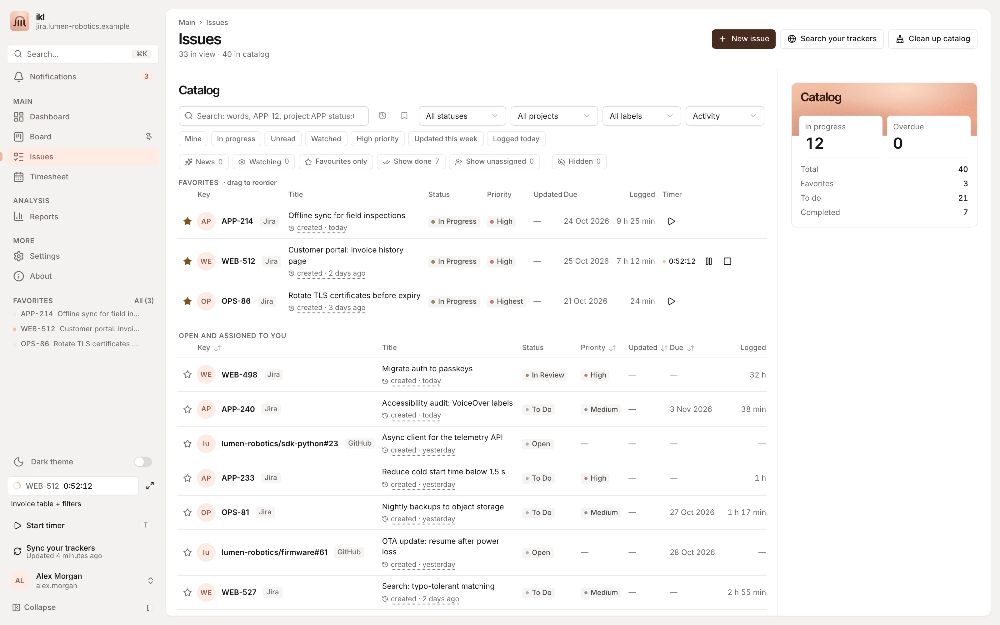 | 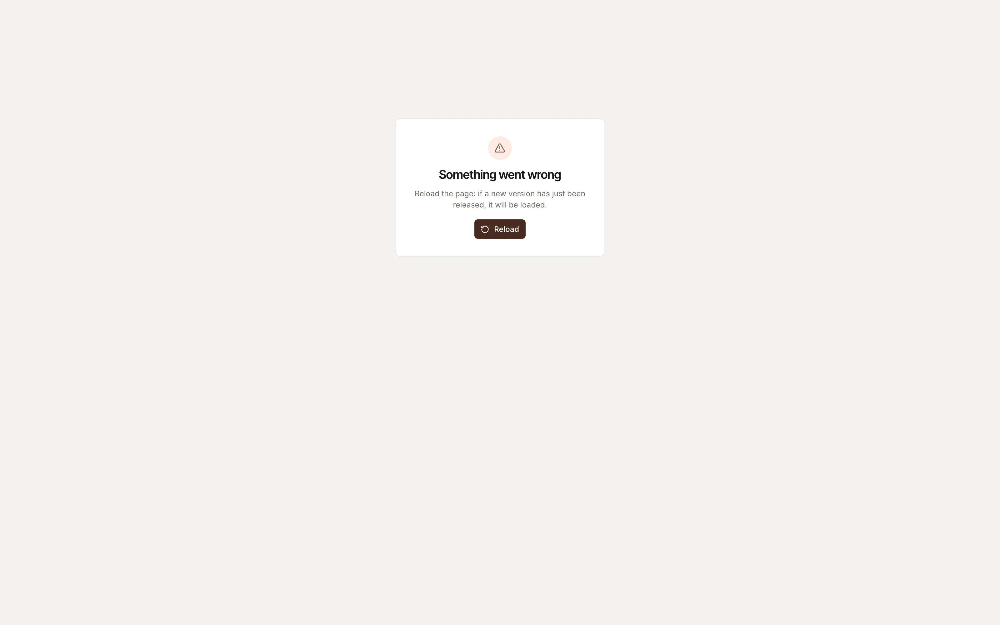 |
| **Issues**: one catalogue, filters, favourites | **Issue detail**: worklogs, comments, timer |
| 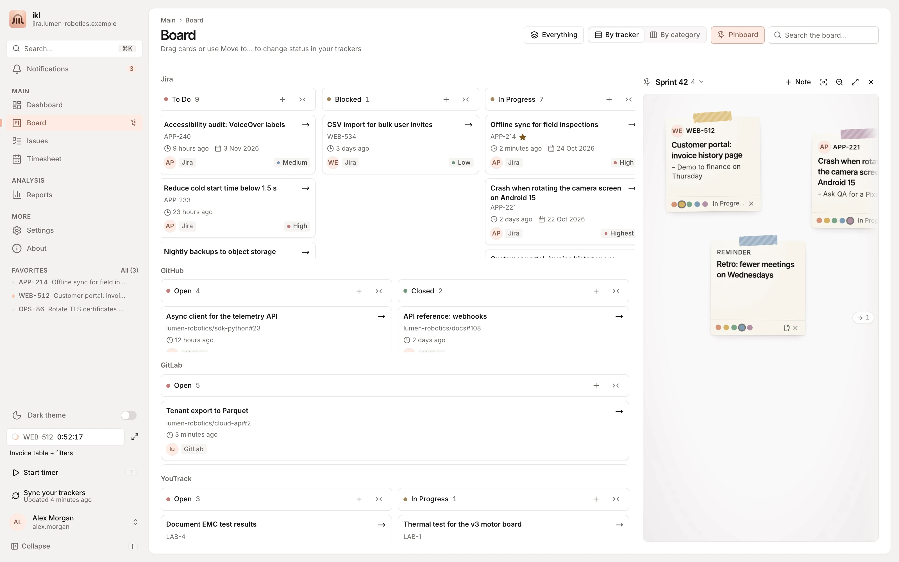 | 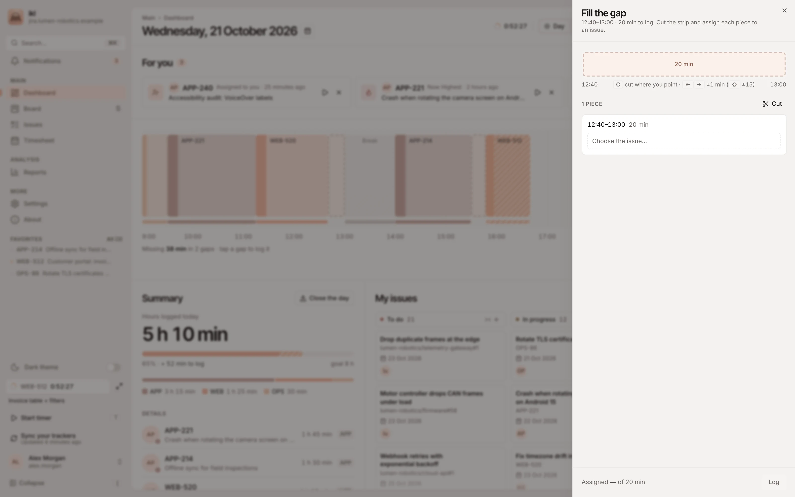 |
| **Board** with the pinboard | **Fill the gap**: cut a hole, assign the pieces |
| 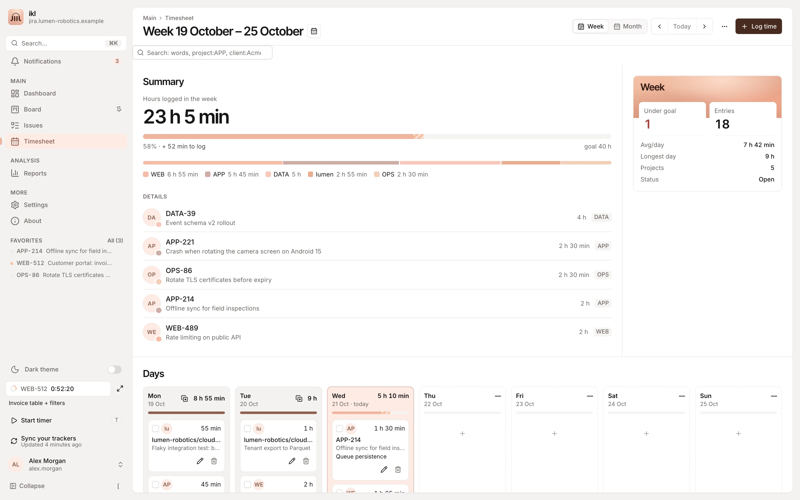 | 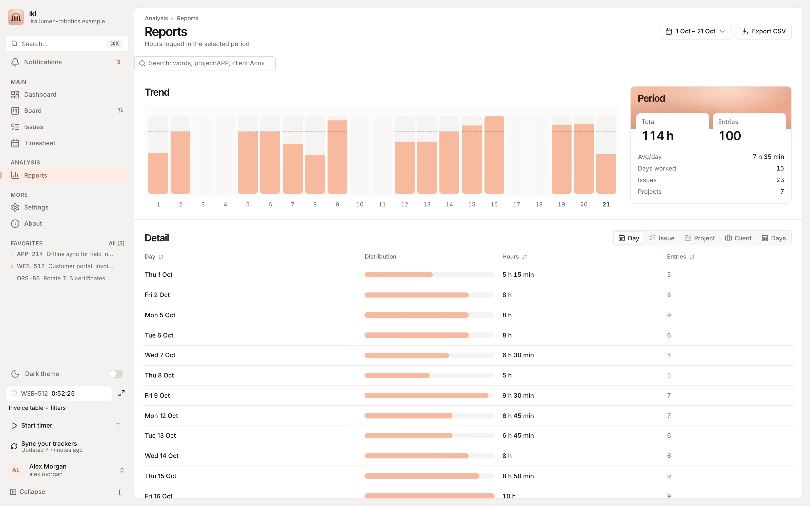 |
| **Timesheet**: the week at a glance | **Reports**: any range, CSV |
| 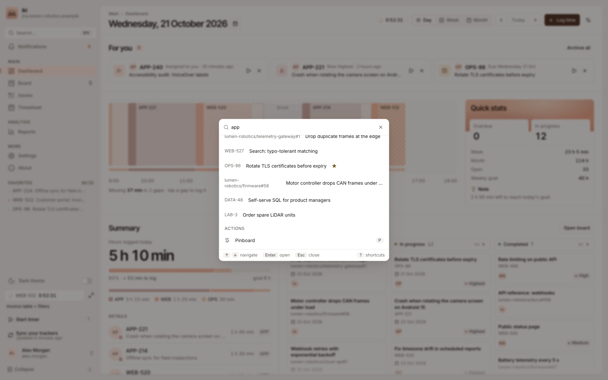 | 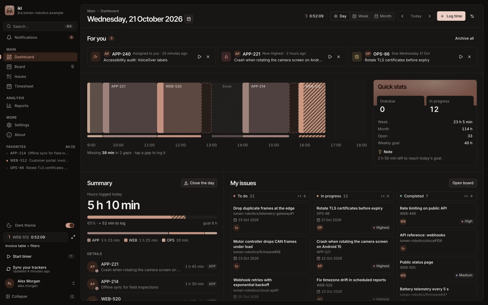 |
| **⌘K** for everything | **Dark theme** |
| 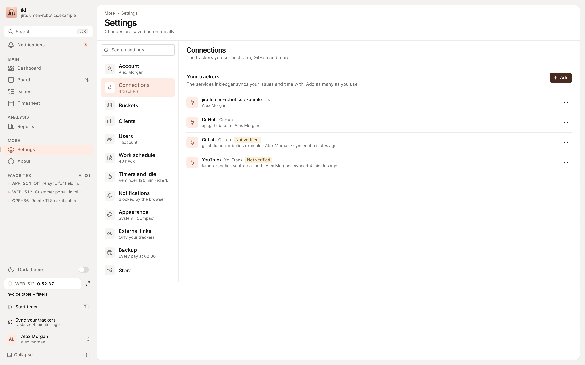 | 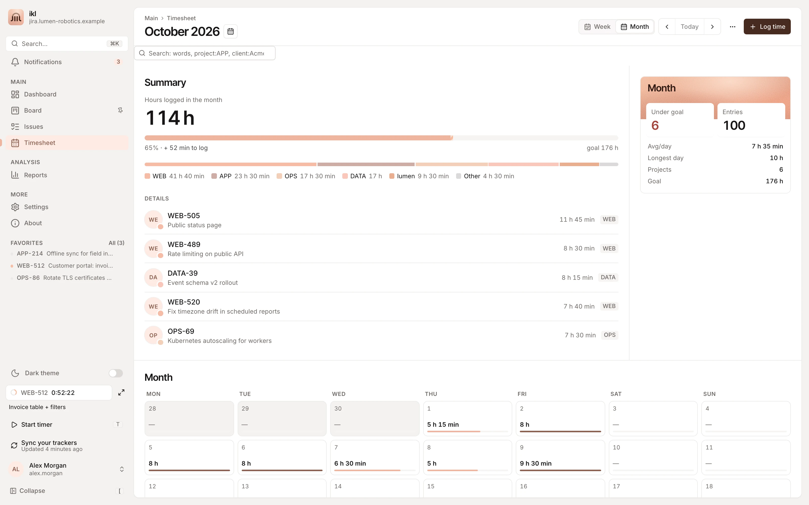 |
| **Connections**: every tracker you use | **Timesheet**: the month |

<p align="center">
  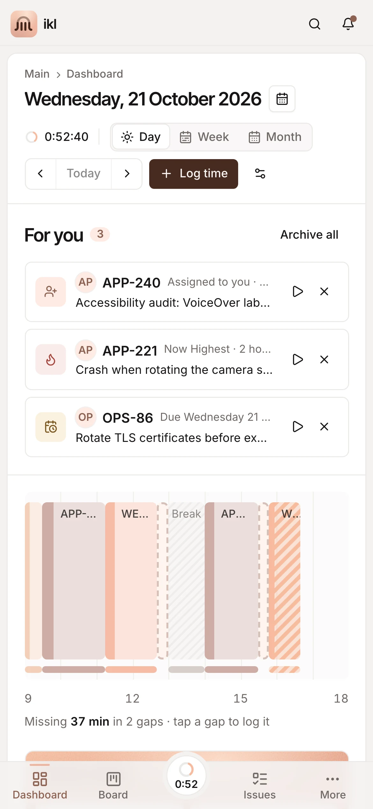
  &nbsp;&nbsp;
  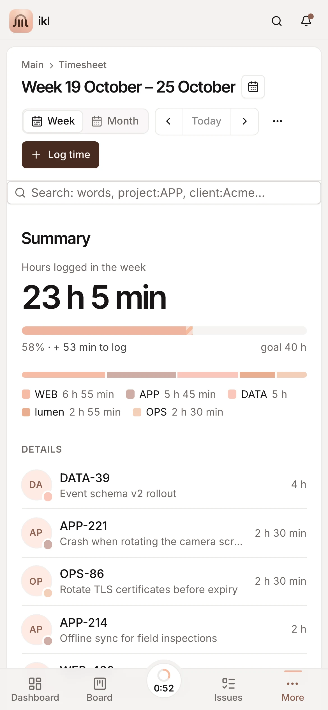
</p>

<sub>All data in the screenshots is fictional.</sub>

## Quick start (Docker)

You need Docker with Compose. The app listens on `http://127.0.0.1:47823` (loopback only).

```bash
git clone https://github.com/inkledger/inkledger.git
cd inkledger

# One-time secrets (the file is gitignored)
PG=$(openssl rand -hex 16)
cat > .env.docker <<EOF
POSTGRES_PASSWORD=$PG
DATABASE_URL=postgres://inkledger:$PG@db:5432/inkledger
SESSION_SECRET=$(openssl rand -hex 32)
# Seals your trackers' credentials; keep it with your backups (a backup holds them sealed)
CREDENTIALS_KEY=$(openssl rand -hex 32)
# Optional: only these self-hosted trackers may be connected
REMOTE_ALLOWED_HOSTS=jira.example.com,gitlab.example.com
EOF

docker compose pull
docker compose up -d
curl http://127.0.0.1:47823/api/health    # {"status":"ok"}
```

Open http://127.0.0.1:47823 and sign in as **admin**. Its first password is `INKLEDGER_ADMIN_PASSWORD` if you set one; otherwise the server makes a random one at the first start and writes it to a file only the server can read: `docker exec inkledger cat /app/data/initial-admin-password`. You must choose a new password first (the file goes then). Then:

- connect your trackers in **Settings → Connections**: Jira with its login (for Server / Data Center your Jira URL, username and password, or a Personal Access Token, Data Center 8.14+, recommended; for Cloud your site URL, Atlassian email and an [API token](https://id.atlassian.com/manage-profile/security/api-tokens)), GitHub with a code on github.com, the others with a personal token (and your server's address for a self-hosted one);
- invite the others from **Settings → Users**: each gets a one-time link (or a QR code) to choose their password.

Upgrading a server from before local accounts: everyone keeps their data, and activates their account from the sign-in page ("Activate your account") with the login of any tracker they had connected, choosing a username and password. Locked out? `docker exec inkledger node dist/cli.js reset-password <username>` prints a temporary password.

Migrations run at start. Backups are scheduled from **Settings → Backup** and land in `~/Backups/inkledger` on the host (`INKLEDGER_BACKUP_DIR` to change it). The container restarts with Docker (`restart: unless-stopped`).

### Local stack updates and CI deployment

`deploy/staging.yml` runs the local stack on `http://127.0.0.1:47824`, beside the legacy `jtt` stack. `pnpm docker:update` dumps its database, builds the current checkout, swaps only the app container and rolls back the image and database if the health check fails. Use `pnpm docker:update --dry-run` to inspect the operation or `--rehearse-rollback` to test recovery.

Releases and deployment run **only on version tags**, never on a push or merge to `main`. Set the version in `package.json`, commit it, then tag that exact commit (`v1.2.3` for version `1.2.3`) and push the tag. CI rejects a tag that does not match the package version.

A successful tag run publishes:

- `ghcr.io/inkledger/inkledger:vX.Y.Z` and `latest`, for both `linux/amd64` and `linux/arm64`;
- a GitHub Release containing the macOS `.dmg`, Windows NSIS `.exe` and SHA-256 checksums;
- the local production update, using the published image digest after every check and artifact build passes.

No Docker Hub account is needed. After the first publication, make the GHCR package public in its GitHub package settings for anonymous downloads. While it is private, add a GitHub PAT with only `read:packages` as the `GHCR_READ_TOKEN` Actions secret so the deployment runner can pull it.

The `deploy` job requires:

- a runner registered for this repository on the Docker host, with the custom label `inkledger` and access to Docker;
- a GitHub `production` environment and an Actions variable `INKLEDGER_ENV_FILE` containing the absolute path of `.env.inkledger` outside the runner checkout;
- the backup directory in `INKLEDGER_BACKUP_DIR`, or its default `~/Backups/inkledger`.

Only tag workflows reach this runner; pull requests run on GitHub-hosted runners. Production deployments are serialized and are not cancelled by another release. The previous image and database dump remain available for recovery.

### Moving real data from development

Do this once, not after every deployment. Stop `pnpm dev` first so no new work is written after the dump. Keep the Docker stack read-only towards trackers until the imported data and connections have been checked.

If dev has no explicit `CREDENTIALS_KEY`, temporarily set `CREDENTIALS_KEY_OLD` in `.env.inkledger` to dev's `SESSION_SECRET`; otherwise set it to dev's old credential key. At boot the server seals the imported tracker credentials again with the Docker stack's `CREDENTIALS_KEY`.

```bash
pnpm docker:from-dev --dry-run
pnpm docker:from-dev --yes
```

The command dumps both databases before changing anything, imports dev's Postgres database and installed modules, and restores the previous Docker database automatically if the import or health check fails. Dumps are private files in the backup directory. Check the application and its logs, then remove `PROVIDERS_READ_ONLY` from `deploy/staging.yml` (or set it to `"0"`) and run `pnpm docker:update` to enable tracker writes. After a successful credential re-seal, remove `CREDENTIALS_KEY_OLD`.

From now on the Docker database is the only live copy. Development uses its own database: running the import again replaces newer production data, and continuing to log in dev does not synchronize it to Docker.

## Development

```bash
pnpm install
docker compose up -d db          # Postgres on 127.0.0.1:54329 (also the container's)
docker exec inkledger-db createdb -U inkledger inkledger_dev   # the dev server's own database
cp .env.example .env             # set DATABASE_URL and SESSION_SECRET
pnpm dev                         # http://localhost:3000
```

The production server marks its database as its own: a development or test process refuses to apply migrations to it (`ALLOW_MIGRATE_PRODUCTION_DB=1` overrides), and any server refuses to start on a database migrated by a newer inkledger.

Use `PROVIDERS_READ_ONLY=1` when you point a development server at a real tracker.

For Lighthouse against the real development data, use `pnpm dev:build` (or its alias `pnpm preview`). It builds the optimized frontend, then serves its assets and SSR from the development backend: login, APIs and the `.env` database keep working. This does not set `NODE_ENV=production` or mark the development database as production-owned. Use `PORT=4173 pnpm dev:build` to run beside the HMR server; rerun the command after frontend changes to rebuild them.

| Command | What it does |
| --- | --- |
| `pnpm dev` | Dev server with HMR (port 3000) |
| `pnpm dev:build` / `pnpm preview` | Optimized build and SSR served by the development backend, with working login, APIs and `.env` database |
| `pnpm build` / `pnpm start` | Production build (`dist/`) and server |
| `pnpm lint` | ESLint and the design-token check |
| `pnpm check` | TypeScript (strict) |
| `pnpm test` | Unit and integration tests (Vitest, Postgres via PGlite) |
| `pnpm test:smoke` | Boots the production bundle: health, headers, SPA fallback |
| `pnpm test:e2e` | Browser regressions (Playwright) against a throwaway database |
| `pnpm db:generate` | Migration from `db/schema.ts` into `drizzle/` |
| `pnpm tauri:dev` / `tauri:build` | Native shell (see [docs/native.md](docs/native.md)) |
| `pnpm native:publish` | Builds the Android app and serves it from `/install` |

## Configuration

| Variable | Default | Description |
| --- | --- | --- |
| `DATABASE_URL` | — | Postgres connection string |
| `SESSION_SECRET` | dev: fixed; prod: **required** | Signs sessions; seals tracker credentials when `CREDENTIALS_KEY` is unset |
| `CREDENTIALS_KEY` (and `CREDENTIALS_KEY_OLD` to rotate) | from `SESSION_SECRET` | Seals tracker credentials (AES-256-GCM, bound to their connection); after a rotation the next start seals them again |
| `PORT` | `3000` | Production port (Docker: `47823`) |
| `INKLEDGER_ADMIN_PASSWORD` | prod: random, in `INITIAL_ADMIN_PASSWORD_PATH` (`data/initial-admin-password`, mode 0600); dev: `admin` | The first admin's password on a new server (it must be changed at the first sign-in) |
| `SESSION_DAYS` | `30` | Lifetime of an unused session (sessions in use are renewed) |
| `REMOTE_ALLOWED_HOSTS` (or `JIRA_ALLOWED_HOSTS`) | any | Comma-separated self-hosted tracker hosts accepted; services on the internet are never limited by it |
| `GITHUB_CLIENT_ID` | the inkledger app | Your own GitHub OAuth App (device flow) for connecting GitHub, instead of inkledger's |
| `PROVIDERS_READ_ONLY` (or `JIRA_READ_ONLY`) | off | Refuse every write to a tracker |
| `SYNC_INTERVAL_MIN` | `5` | Minutes between background syncs (`0` disables) |
| `STORE_URL` | the inkledger store | Module store (Settings → Store); `off` disables it |
| `INSTANCE_KEY_PATH` | `data/instance.key` | This server's own key for module licences (made once; a copied database is not a copied server) |
| `WEATHER` | `on` | Real weather for modules that ask for it (Open-Meteo); `off` disables it |
| `ALLOWED_HOSTS` | `localhost,127.0.0.1,::1` | Host names the server answers to (LAN and Tailscale names are added from the app) |
| `TRUST_PROXY` | off | Client IP from `X-Forwarded-For` (behind a TLS proxy) |
| `COOKIE_SECURE` | auto | Force `Secure` cookies behind a proxy without `X-Forwarded-Proto` |
| `BACKUP_DIR` | Docker: `/backups` | Where scheduled backups are written |
| `TZ` | system | Time zone for days and weeks (Docker inherits the host's) |

### Connecting GitHub

Settings → Connections → Add → GitHub: inkledger shows a short code, you enter it on github.com and authorize, and the connection is made. No password or token is pasted into inkledger and no callback URL is needed, so it works on a private address too. Connect as many GitHub accounts as you use (switch account on GitHub before each).

inkledger asks for `repo`, `read:project`, `project` and `notifications`. GitHub keeps no time: time logged on GitHub issues stays in inkledger. To use your own OAuth App instead (device flow enabled), set `GITHUB_CLIENT_ID`.

## Add-on modules

inkledger can load optional **add-on modules**: small, signed packages that add something on top of the app without touching your data. They come from **Settings → Store**: a module in free release has a **Request licence** button (your email and an optional message go to the developer; once approved, inkledger installs the module by itself), a paid one shows its price and the payment methods. Click a module's status badge to manage it (settings, export or import its progress, uninstall, remove the licence); a module whose licence you hold reinstalls or updates from there with one click. Each module has its own on/off switch, and another switch turns them all off on a device. A module starts from zero when installed; its progress can be exported to a file and brought back. A module runs inside your own inkledger: no account, no tracking. A licence is activated on up to three of your servers (Settings → Store shows them), renewed every 90 days with 30 days of grace when the store can't be reached; a server that never reaches the internet is activated with an offline code.

Licences follow the [module terms](docs/modules-terms.md). The store and, when a module asks for real weather, [Open-Meteo](https://open-meteo.com) are the only outbound calls besides your trackers (weather requests carry only coordinates rounded to 0.1°, are cached 30 minutes and stop with `WEATHER=off`): this server asks the store for the catalog when someone opens Settings → Store (at most every 12 hours; the last copy is kept), and for the licence while a request or a payment is pending. `STORE_URL=off` turns it off.

| Module | What it is | |
|---|---|---|
| **Kanbunny** | A felt desk bunny that lives on the bottom edge of your work. It eats a carrot for every ticket you close, hops when cards move, levels up with the hours you log and collects trophies and outfits. It always finds a spot that does not cover what you read. | [Overview, video and PDF](docs/kanbunny/README.md) |
| **Desk Radio** | A little felt cassette at the bottom of the sidebar: lo-fi stations and tapes, rain, café, fireplace or forest sounds made live in your browser. It answers closed tickets with a chord, plays a warm sweep at your daily goal and keeps playing in the folded rail or on a phone. | [Overview, video and PDF](docs/deskradio/README.md) |
| **Stitch** | An embroidery hoop on your dashboard: the hours you log this week stitch a cross-stitch pattern, finished exactly at your weekly goal. Closed tickets add gold, every week joins a collection and any week saves as a picture. | [Overview, video and PDF](docs/stitch/README.md) |
| **City Window** | A train window behind your Dashboard: painted worlds roll past under the real sky and weather where you are, every closed ticket lights a window and your daily goal brings a station with fireworks. In beta. | [Overview and pictures](docs/citywindow/README.md) |
| **Bonsai** | A maple bonsai on your dashboard, path traced like a photograph: the hours you log make it grow, closed tickets bring buds and flowers, your daily goal makes it bloom, through the real seasons. In beta. | [Overview and pictures](docs/bonsai/README.md) |
| **Shadow** | Real shadows across the whole app: buttons, cards, menus and the panel cast a shadow away from the sun or the moon where you are, long at dawn and sunset, short at noon, faint by moonlight, none on a dark night. Nothing animates. | [Overview and pictures](docs/shadow/README.md) |

These modules are in free release: request a licence from the store.

<p align="center">
  <a href="docs/kanbunny/README.md"></a>
</p>

## Native apps and devices

The native app is a thin Tauri shell around your server: menu bar and tray timer, global shortcuts (⌥⇧T start, ⌥⇧P pause, ⌥⇧J show), system idle detection, notifications and launch at login. It keeps several **server profiles**, each with its own tracker connections and user.

From **Settings → Devices** you can add a phone or another computer. Use Tailscale (HTTPS on your tailnet, published on the same port the server uses locally) or the local Wi-Fi: the app creates a local certificate authority, and the phone installs it once from a QR code. Android downloads the APK from `/install`; on iPhone, inkledger installs as a web app. Details are in [docs/native.md](docs/native.md).

## Security and privacy

- Self-hosted, **no telemetry**. Outbound calls go to the trackers you connect, to the module
  store (only when Settings → Store is opened or a licence is pending; `STORE_URL=off` stops it)
  and to Open-Meteo for modules that ask for weather (coordinates rounded to 0.1°; `WEATHER=off`).
- In production, without `REMOTE_ALLOWED_HOSTS`, only an admin may connect a self-hosted tracker.
- Tracker secrets are sealed with AES-256-GCM, bound to their connection, and only used server-to-tracker.
- Trackers not verified on a real account only read until you allow writes; `PROVIDERS_READ_ONLY=1` refuses every write.
- `HttpOnly` / `SameSite=Lax` cookies (`Secure` over HTTPS), session ids stored as hashes, `Origin` check on writes, rate-limited sign-in.
- Remembered devices hold only a rotating token. The remembered token is rotated on every use.
- Tracker URL guard (no loopback or link-local), host allowlists, security headers, body limits.

## Architecture

```
api/          Hono + tRPC server: routers, tracker and time-tracker providers (api/providers/<type>, each with an HTTP simulator), outbox, sync, webhooks, backups
contracts/    Code shared by app and server: durations and local dates, placement, schedules, i18n
db/           Drizzle schema → drizzle/ migrations (applied at start; a test catches drift)
src/          React 19 app: pages, feature components, design primitives (src/components/app)
src-tauri/    Native shell (Rust): profiles, tray, shortcuts, idle, LAN HTTPS, Tailscale
api/modules/, src/modules/   Add-on module loader: signed packages, licences, slots, host API
e2e/          Browser regressions, one per interaction that ever broke
```

**Stack:** React 19, Vite 7, Tailwind CSS, Radix UI, TanStack Query, tRPC 11, Hono, Drizzle ORM, Postgres 17, Tauri 2, Node 24.

## Contributing

Issues and pull requests are welcome: see [CONTRIBUTING.md](CONTRIBUTING.md) for the setup (the
end-to-end tests need Postgres and Chromium). Security issues: [SECURITY.md](SECURITY.md). Before
opening a PR, run:

```bash
pnpm lint && pnpm check && pnpm test && pnpm build && pnpm test:smoke && pnpm test:e2e
```

If you fix an interaction bug, add a test for it in `e2e/`. User-visible text goes in `contracts/i18n/en` and `contracts/i18n/it`. The typecheck fails if the two languages don't have the same keys.

## License

[MIT](LICENSE) © lorenzomusche
