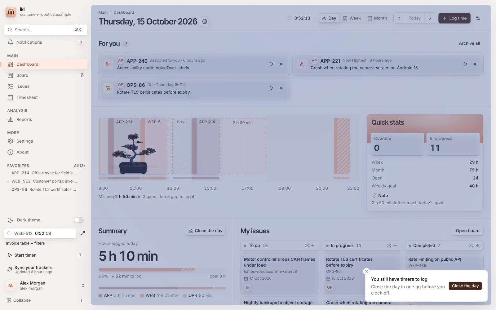
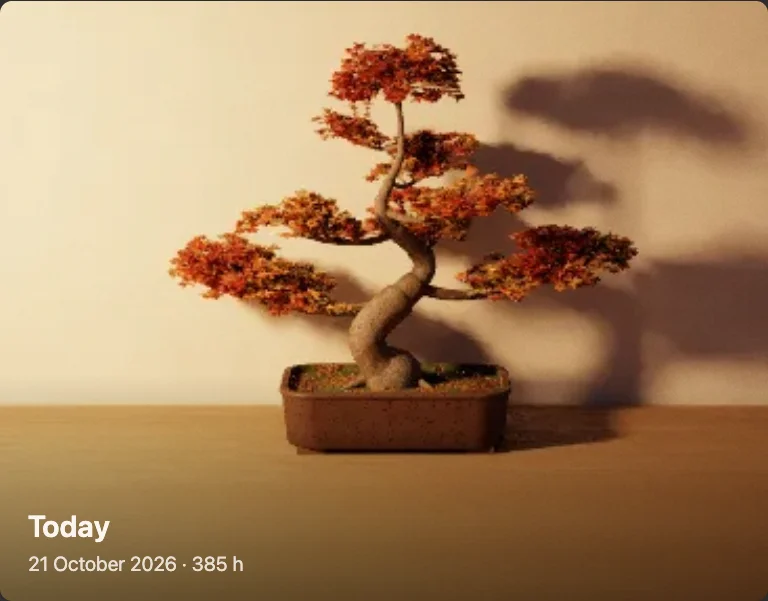

<h1 align="center">Bonsai</h1>

<i>A tree that grows with your work</i>

  

  <a href="../../README.md#add-on-modules">Back to inkledger</a>

Bonsai is an [add-on module](../../README.md#add-on-modules) for inkledger. A bonsai in a glazed pot sits on your dashboard: a maple at first, then a pine, a juniper and a cherry as your hours grow. The hours you log make it grow, the tickets you close bring buds and flowers, and your daily goal makes it bloom. It follows the real seasons.

  

> **Requires WebGL2.** The tree is drawn on your graphics card, so Bonsai can only be installed in a browser with WebGL2 (any recent Chrome, Edge, Firefox or Safari with hardware acceleration on). Where it is missing, the Store shows the install button disabled, with an ⓘ that explains why.

## What it does

- **On your day.** By default the tree stands at the left end of the day timeline, on the baseline of your entries, on a transparent ground, about 200 px tall when grown (its size never changes as it grows); a click on it opens its settings. It is lit by the real sun for where you are: morning light from the east (the left in the northern hemisphere, the right in the southern), evening light from the west, warm and low at dawn and sunset, high at noon, the moon at night. Shadows over the rest of the page are the [Shadow](../shadow/README.md) module's: with it, the page and the tree share the same sun, and the tree dims with the page at night. Prefer the **On your desk** card? It shows the same tree beside its words; with both, the tree stands on the timeline and the card keeps its words. Choose in its sheet in **Settings → Store**.
- **Grown by your hours.** It starts as a sapling in its pot. The trunk thickens and branches spread as the hours you log add up.
- **Buds and flowers.** Every ticket you close today adds a bud on the outer tips; every second one opens a flower.
- **In bloom at your goal.** Reach your daily goal and the whole tree blossoms.
- **Four species.** A maple from the first day; a pine at 40 hours, a juniper at 100 and a cherry at 200 hours logged. Pick one in its sheet in **Settings → Store**.
- **The real seasons.** New leaves in spring, full green in summer, red and gold in autumn, bare branches in winter, by your hemisphere.
- **Watch it grow.** In its sheet, **Watch it grow** plays the tree's story from the day you planted it: every growth step, season, new species and round number of hours, cross-faded, with the date and the hours. Save it as a video. The pictures are made on a computer while the page is quiet (a few seconds each), then kept.
- **A photograph, not a drawing.** The picture is path traced on your GPU: real light, soft shadows, depth of field. The pot takes your theme colour, and a theme change is a relight in a few milliseconds, never a new trace.
- **Light on your machine.** The tree is drawn only when it changes (on the timeline the light is kept apart: the tree is traced once per change under four basis lights, and every 5-minute step of the sun is a millisecond's mix of them; the traced pictures are also kept on your inkledger server, so your other devices, phones included, download them instead of drawing), in small slices that leave the page smooth; it waits while you click, type or scroll, and while the card is out of sight. The rest of the time it is a cached picture that costs nothing, and the tree is never blank while a new picture comes: the last one stays. Should WebGL2 go missing later (e.g. hardware acceleration turned off), the nearest tree already drawn stands in, your other devices are asked to draw the missing one, and the card falls back to a simpler renderer.

## Pictures

| | |
|---|---|
|  |  |
|  |  |
|  |  |
|  |  |

## Install

1. **Request a licence.** In inkledger, open **Settings → Store** and press **Request licence** next to Bonsai. Bonsai is in free beta.
2. **Wait for the approval.** You can close the panel: once the request is approved, inkledger installs and activates the module by itself.
3. **Watch it grow.** Open the dashboard: your bonsai stands at the left end of the day timeline.

Good to know:

- It runs inside your own inkledger: no account, no tracking, nothing leaves your server.
- The licence is shared by everyone on your inkledger server and activated on up to three of your servers; it is renewed in the background every 90 days (a server that never reaches the internet is activated with an offline code from Settings → Store).
- Manage it from its status badge in **Settings → Store** (species, uninstall, remove the licence, reinstall); a switch there turns all modules off.
- It counts the hours logged since it was installed: the tree starts small on the day you install it.
