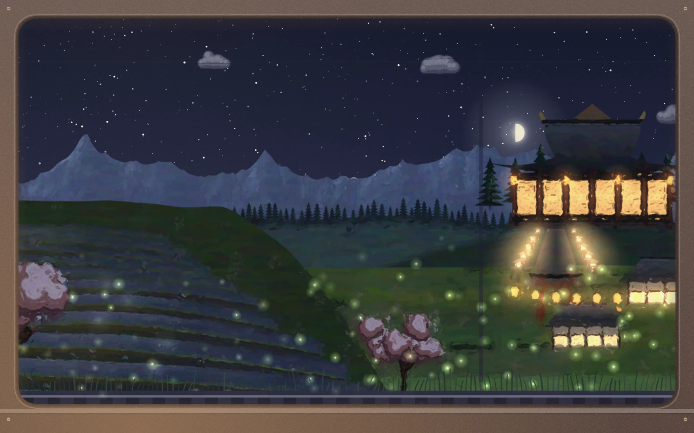
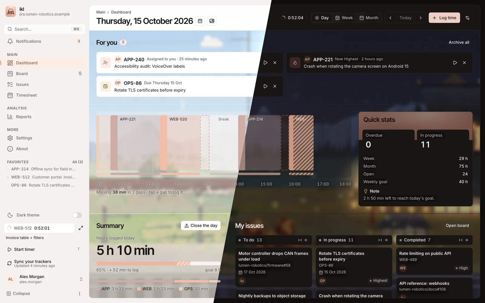
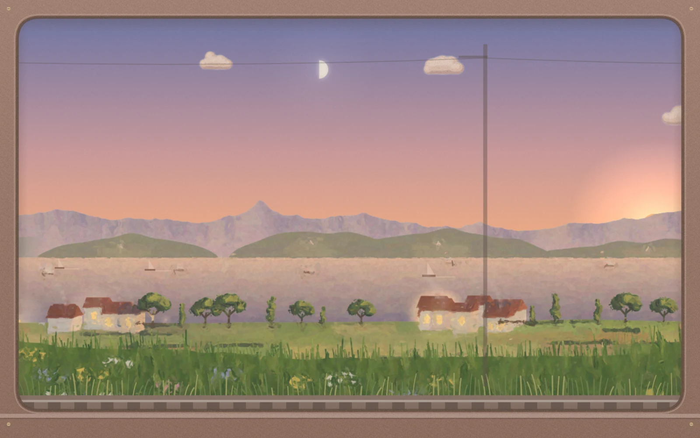
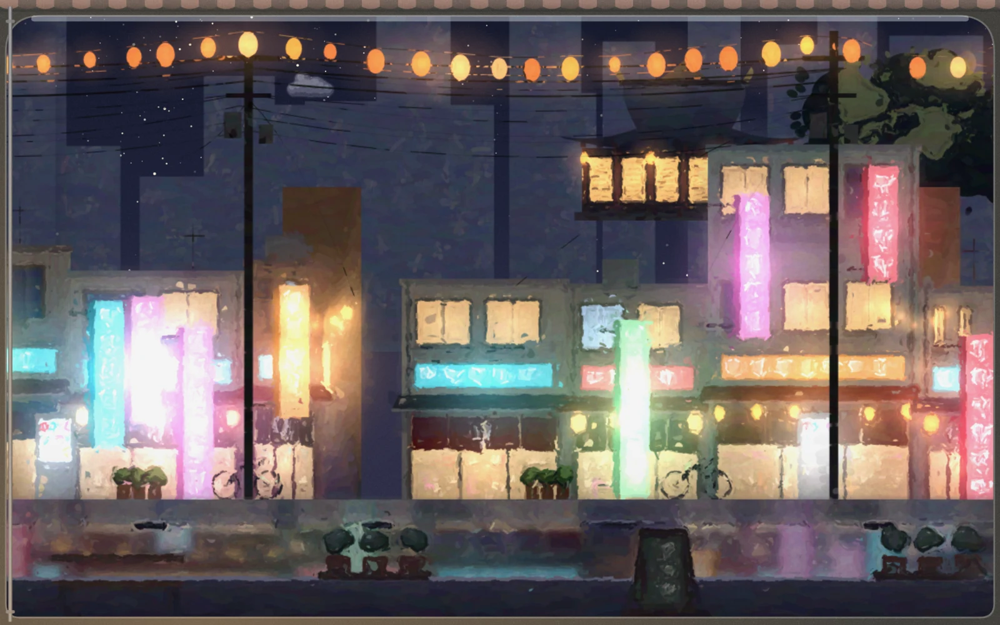
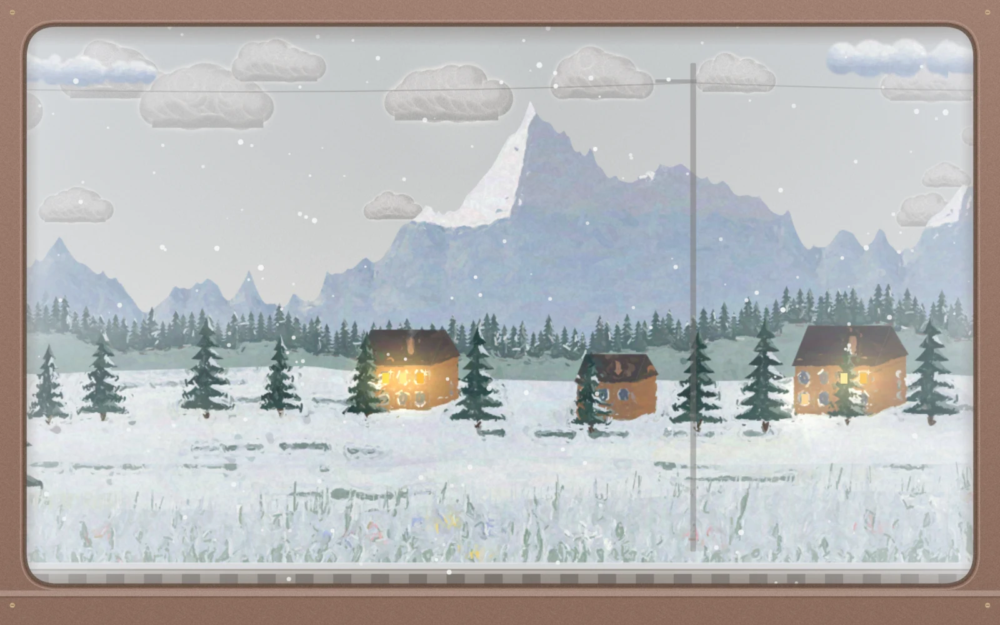
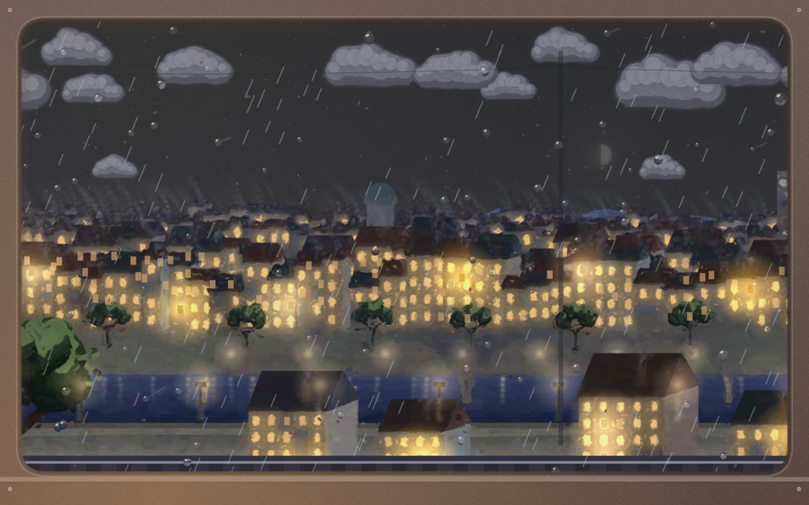
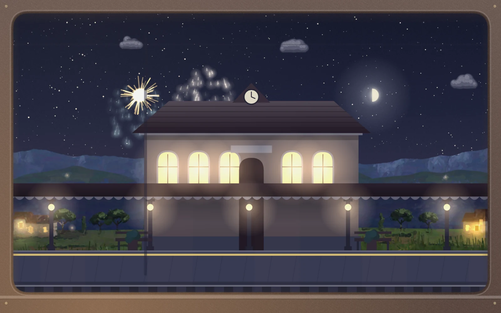

<h1 align="center">City Window</h1>

<i>A train window behind your dashboard</i>

  

  <a href="../../README.md#add-on-modules">Back to inkledger</a>

City Window is an [add-on module](../../README.md#add-on-modules) for inkledger. Behind your Dashboard, softly blurred, painted landscapes roll past a train window under the real sky where you are. The hours you log move you along the line, and your work lights it up.

  

## What it does

- **Eight worlds, five routes.** Countryside, coast, city, mountains, forest, desert, Japan and its neon alleys, seen from a tuk-tuk. The hours you log move you along routes such as the Meadow Line or the Night Market Loop.
- **A light for every ticket.** Every ticket you close lights a window along the line; a high-priority one lights a golden window. A card moved on the Board sends a train past on the other track.
- **A station at your goal.** Reach your daily goal and the train pulls into a station with fireworks.
- **The real sky.** Sunrise, sunset and the moon follow your location; the weather is sunny, rainy, variable or the real one near you.
- **Your theme.** The window frame takes your theme's colours, light or dark, and the scene stays behind your work, blurred and veiled so the text reads.
- **Settings in the Store.** Weather, place, time of day, season, speed, staying in one world and postcards are in its sheet in **Settings → Store**.

## Pictures

| | |
|---|---|
|  |  |
|  |  |
|  |  |

## Install

1. **Request a licence.** In inkledger, open **Settings → Store** and press **Request licence** next to City Window. City Window is in free beta.
2. **Wait for the approval.** You can close the panel: once the request is approved, inkledger installs and activates the module by itself.
3. **Look out of the window.** Open the Dashboard: the journey starts behind it.

Good to know:

- It runs inside your own inkledger: no account, no tracking. With real weather on, only your coordinates rounded to 0.1° go to Open-Meteo, through your inkledger server.
- The licence is shared by everyone on your inkledger server and activated on up to three of your servers; it is renewed in the background every 90 days (a server that never reaches the internet is activated with an offline code from Settings → Store).
- It is smooth and light: 60 frames a second in step with your display, the blur baked into a small picture the GPU scales up, so the page stays fluid even on modest computers. It pauses while the tab is hidden and respects the system's reduced-motion setting.
