<h1 align="center">Desk Radio</h1>

<i>A lo-fi cassette radio for inkledger</i>

  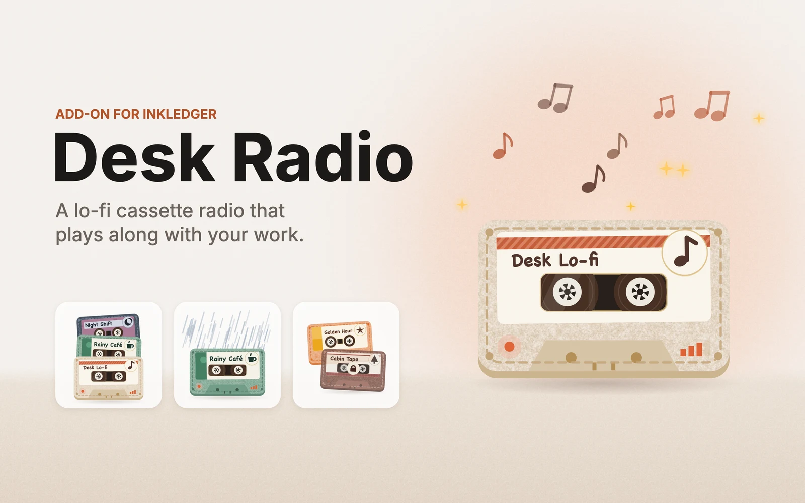

  <a href="deskradio.mp4"><b>Watch the video</b></a> ·
  <a href="deskradio.pdf"><b>Read the overview (PDF)</b></a> ·
  <a href="../../README.md#add-on-modules">Back to inkledger</a>

Desk Radio is an [add-on module](../../README.md#add-on-modules) for inkledger. A little felt cassette lives at the bottom of the sidebar: press play and it plays lo-fi music, with rain, café, fireplace or forest sounds mixed in if you like. Everything is synthesized live in your browser: no audio files, no streams.

  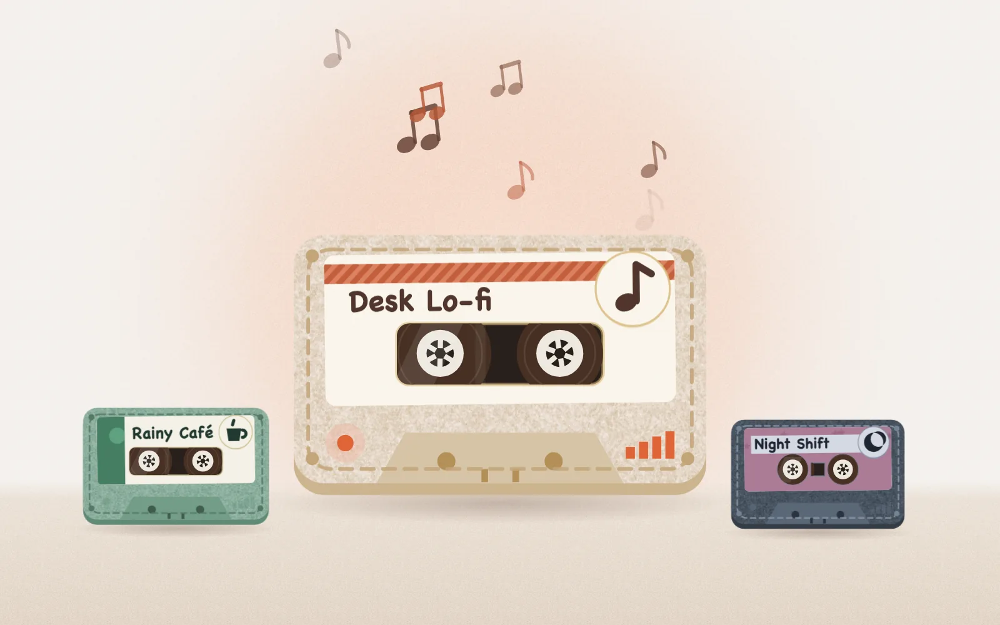

## What it does

- **Lives in the sidebar.** One small row under the navigation: the cassette, what is playing, the volume and a play button. It never moves the sidebar and never covers a link.
- **Stations and tapes.** Three stations from the start (Desk Lo-fi, Rainy Café, Night Shift) and five tapes to earn with the hours you log and the tickets you close: Sunday Morning, Deep Focus, Golden Hour, Midnight Commit and Cabin Tape. Each one has its own groove, its own instruments and its own cassette.
- **A mixer.** Music, rain, café, fireplace and forest, each with its own slider.
- **Plays along with your work.** Close a ticket and it answers with a chord (a brighter one for high-priority tickets); reach your daily goal and it plays a warm sweep. Turn on *Follow the timer* and it fades in when a timer starts and out when it stops.
- **Focus mode.** When inkledger's focus mode is on, the radio switches to a softer mix and the cassette dims.
- **Wherever you work.** Fold the sidebar and it plays on as an icon in the rail. On a phone it has a row in the More sheet, and while it plays it docks as a small pill above the tab bar.
- **Its own panel.** Click the cassette: a side panel slides in with the stations, the tapes and how close each one is, and the mixer, with no backdrop, so your page stays usable. Its settings are in its sheet in **Settings → Store**.
- **Polite with sound.** Nothing plays before your first click, and no audio is set up before it.

## Screenshots

| | |
|---|---|
| 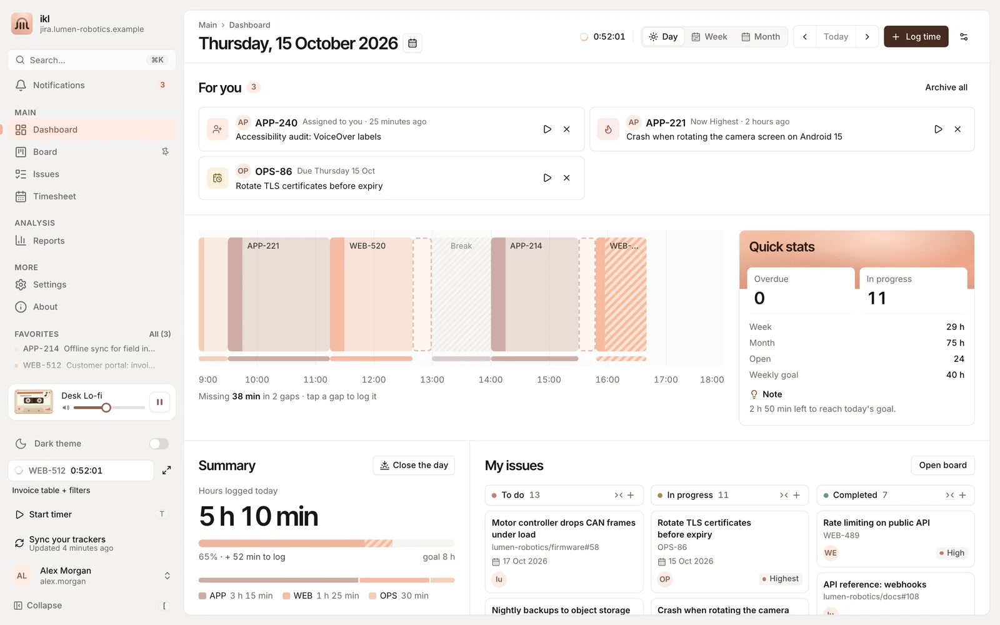 | 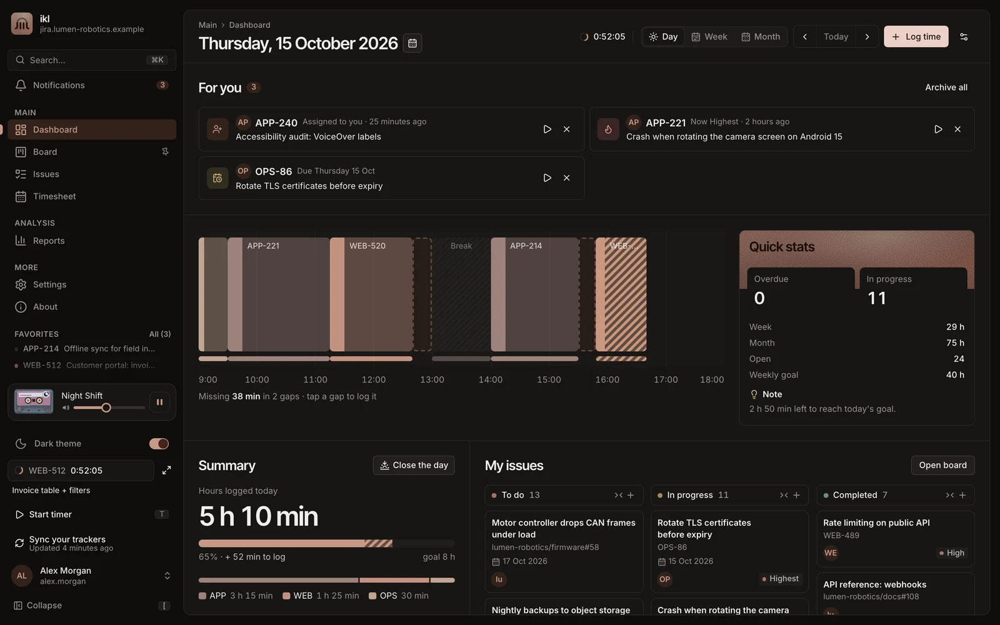 |
| 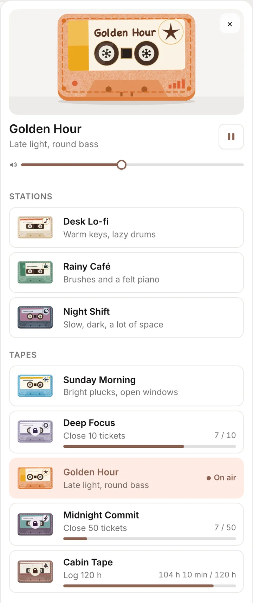 | 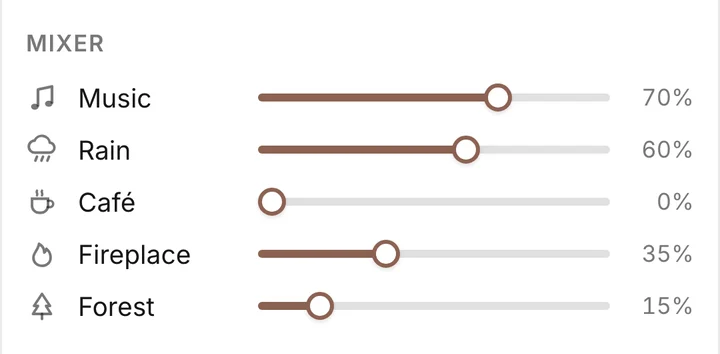 |
| 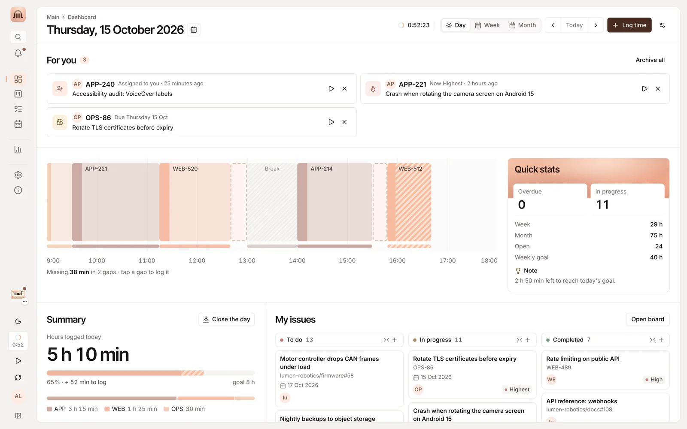 | 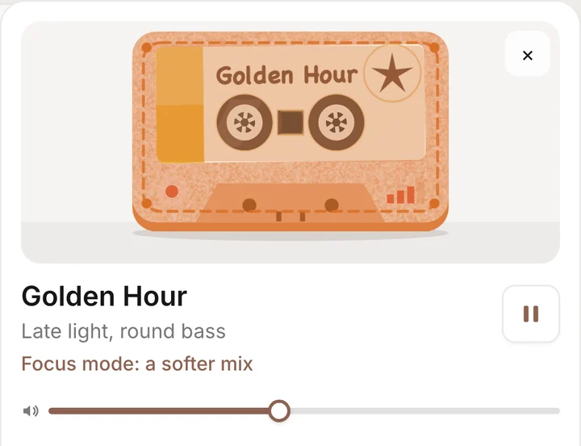 |
| 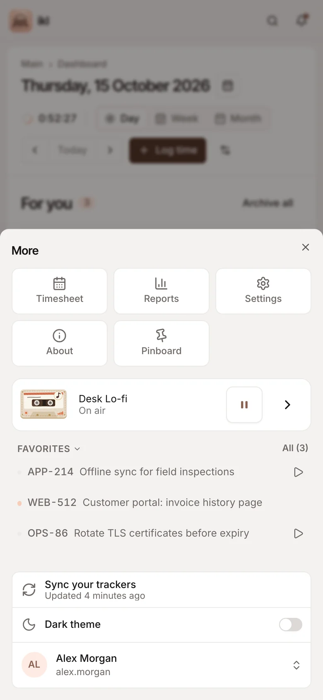 | 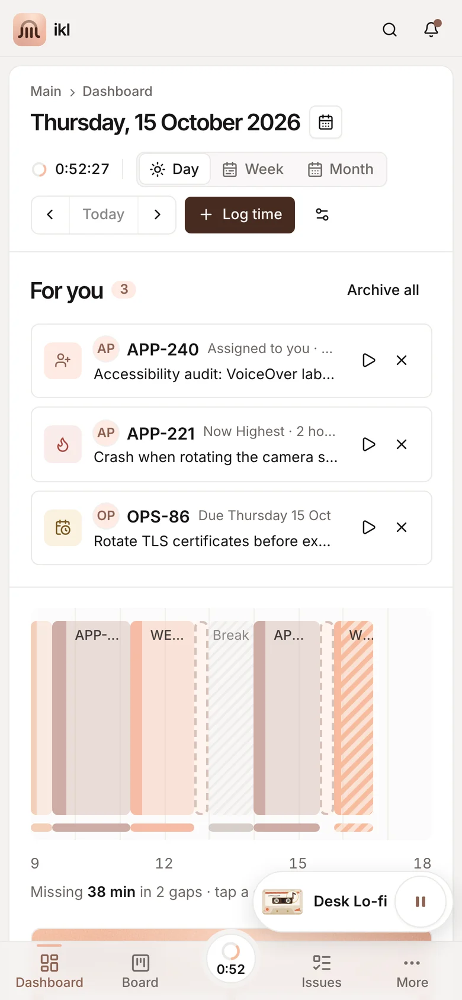 |
| 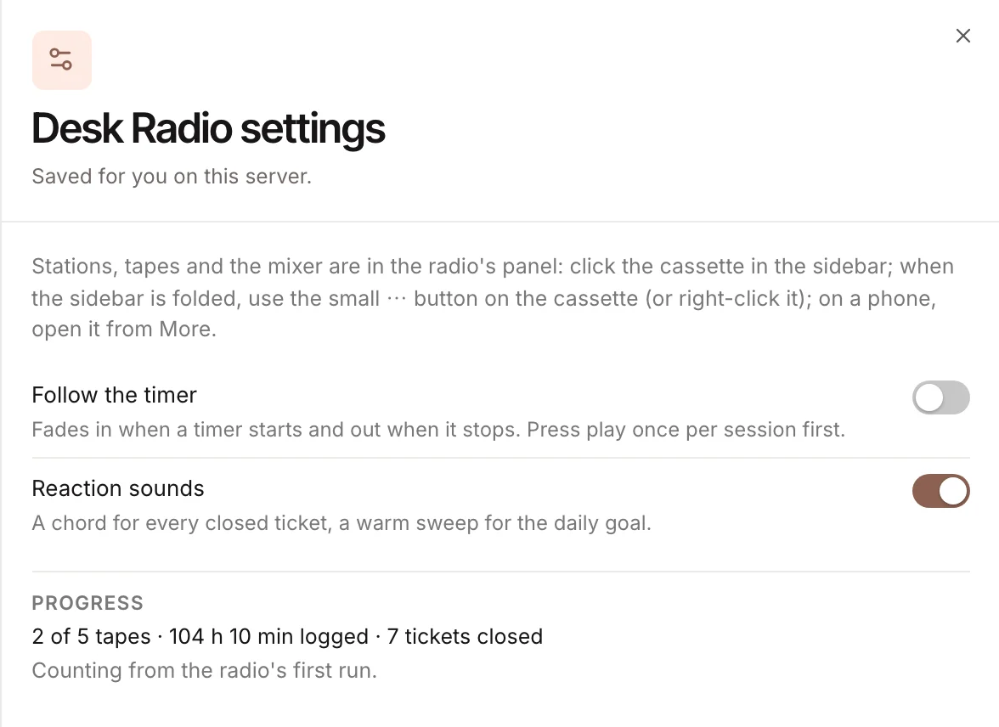 | |

## Install

1. **Request a licence.** In inkledger, open **Settings → Store** and press **Request licence** next to Desk Radio. Desk Radio is in free release.
2. **Wait for the approval.** You can close the panel: once the request is approved, inkledger installs and activates the module by itself.
3. **Press play.** Look at the bottom of the sidebar: the cassette is waiting.

Good to know:

- It runs inside your own inkledger: no account, no tracking, nothing leaves your server.
- The licence is shared by everyone on your inkledger server and activated on up to three of your servers; it is renewed in the background every 90 days (a server that never reaches the internet is activated with an offline code from Settings → Store).
- Manage it from its status badge in **Settings → Store** (settings, uninstall, remove the licence, reinstall); a switch there turns all modules off.
- Tapes count the hours and tickets from the radio's first run.
- It respects the system's reduced-motion setting.
