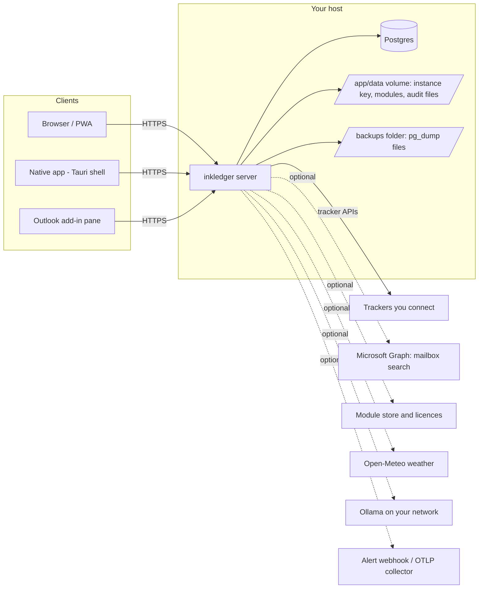

# Data flow

Where data enters inkledger, where it is stored, and how long it stays. The server is the only place data lives: browsers and the native app show it and send changes back. Outbound traffic, host by host, is in [outbound.md](outbound.md).

## Diagram

Dotted lines are off until configured (or can be turned off): see [outbound.md](outbound.md). The server sends no telemetry.

## Data groups

"Personal" means it relates to an identifiable user (account holders, the people they log time for, mail senders). "Sealed" means AES-256-GCM with `CREDENTIALS_KEY` ([runbook-rotation.md](runbook-rotation.md)); everything else is plain in the database and protected by access to the database, the host and the backups. Retention is what the server's purge does on its own (every 6 hours in production); "until deleted" means nothing removes it automatically.

| Group | Tables | Personal | Encrypted at rest | Retention |
| --- | --- | --- | --- | --- |
| Accounts | `users`, `invites` | Yes (username, display name, email, role) | Password as a scrypt hash; invite tokens as hashes | Until the account is removed; invites until they expire (7 days) |
| Sessions and devices | `sessions`, `remembered_devices` | Yes | Ids and tokens kept as hashes | Until expiry (`SESSION_DAYS`, 30 by default, renewed while in use); expired ones purged; ended on password reset, change or disabling the account |
| Tracker connections | `connections`, `connection_sync`, `sync_state`, `outbox`, `write_leases` | Yes (tracker login, mapping to the user) | Credentials and webhook secrets sealed; status and sync state plain | Until the connection is removed |
| Time and work | `worklogs`, `worklog_trash`, `worklog_sinks`, `planned_entries`, `timers`, `timer_runs`, `timer_shares`, `week_locks`, `work_schedules`, `work_day_overrides`, `todo_sessions` | Yes | No | Worklogs until deleted; deleted worklogs 30 days in the trash; timer runs 30 days; timer operations 1 day |
| Issues and planning | `issues`, `issue_notes`, `issue_history_reads`, `activity`, `issue_status_changes`, `status_snapshots`, `work_statuses`, `containers`, `container_paths`, `buckets`, `bucket_columns`, `bucket_sources`, `clients`, `client_containers`, `saved_queries`, `recent_queries`, `desks`, `item_aliases`, `sink_mappings` | Mostly (tracker content, names of assignees) | No | Until deleted or the connection is removed |
| Notes, to-dos, ideas | `markdown_notes`, `markdown_note_versions`, `todos`, `pinboards`, `pinboard_notes`, `ideas`, `decisions` | Yes | Idea pictures (`idea_files`) sealed; the rest plain | Deleted notes and ideas 30 days in the trash; answered or ended decisions 7 days |
| Mail (opt-in) | `mail_accounts`, `mails`, `mail_links`, `mail_addin_keys`, `mail_copies`, `mail_copy_reads` | Yes (sender, subject, body of pinned mails) | Mailbox sign-ins and mail copies sealed | Copies not pinned any more 7 days; read records 365 days; the rest until the user signs out of the mailbox or deletes it |
| Notifications | `notifications` | Yes | No | Dismissed ones 30 days |
| Settings and preferences | `settings`, `device_prefs`, `saved_queries` | Yes | No | Until deleted |
| Flow analysis (opt-in, per user) | `workspace_flow_*`, `workspace_*` | Yes | No | Raw events 30 days and aggregates 365 days by default (each user can change both); other workspace state is pruned by the same purge |
| Module data | `module_storage`, `module_files`, `issue_closures`, `module_closure_claims` | Yes | No | Files not read for 30 days; the rest until deleted |
| Webhook intake | `webhook_deliveries` | Possibly (tracker payload ids) | No | 2 days |
| Server settings | `server_settings`, `server_hosts`, `egress_hosts` | No (settings, host names and call counts only) | Secrets inside (alert webhook) sealed | Until changed |
| Audit log | `audit_events` | Yes (actor, client address, hash of the User-Agent) | No; append-only and hash-chained | `audit.retentionDays`: 400 days by default, never under 90 ([audit.md](audit.md)) |

Files outside the database:

| Where | What | Personal | Protection | Retention |
| --- | --- | --- | --- | --- |
| `BACKUP_DIR` (`/backups`) | `pg_dump` files: a full copy of the database | Yes | Files readable by the server's user only (mode 0600); sealed values stay sealed. Not encrypted as files | The newest N (`keep`, 14 by default) |
| `/app/data/audit` | Daily `audit-YYYY-MM-DD.jsonl` copy of the audit log, restore records | Yes | File permissions | Until you rotate or ship them |
| `/app/data` | Module licence identity (`instance.key`), installed modules, downloads | No | File permissions | Until removed |
| HTTPS certificate folder | Local CA and server certificate | No | File permissions | Until renewed |

Two copies matter for backups: the database dump holds everything above in the database, and `CREDENTIALS_KEY` is needed to open the sealed values. Keep them apart ([../../SECURITY.md](../../SECURITY.md)).

## In transit

Clients reach the server over HTTPS (the Docker stack serves it itself, or put your own proxy in front: [../https.md](../https.md), [../self-hosting.md](../self-hosting.md#https-and-the-certificate)). Tracker and service calls are made by the server, over the address of each service. Tracker credentials never reach the browser.
