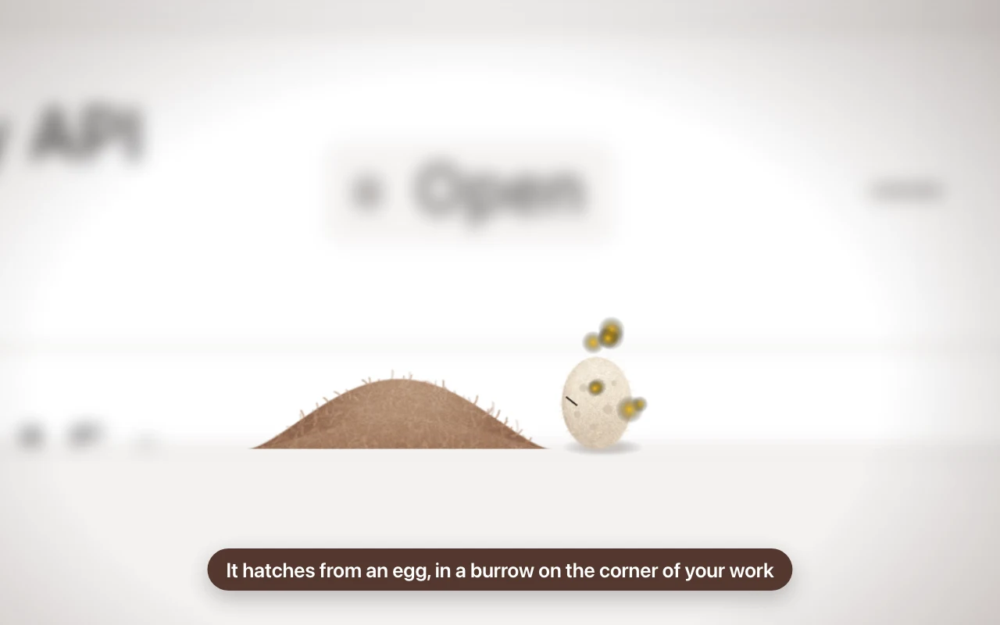
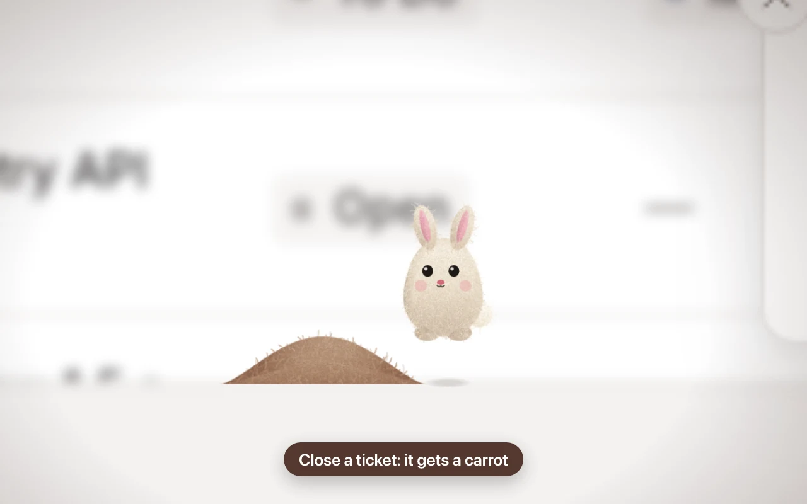
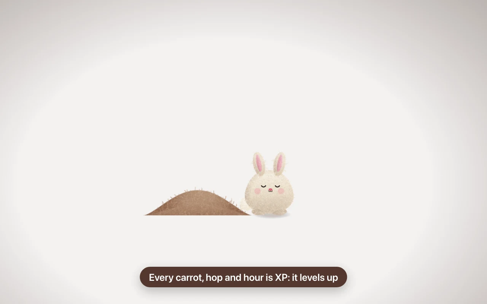
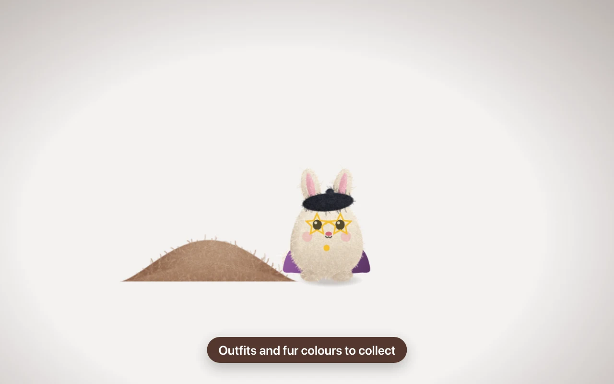
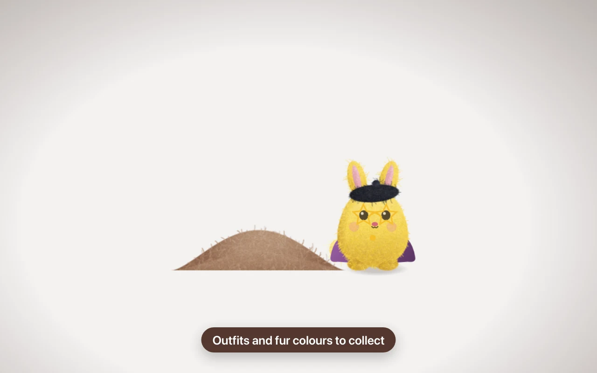
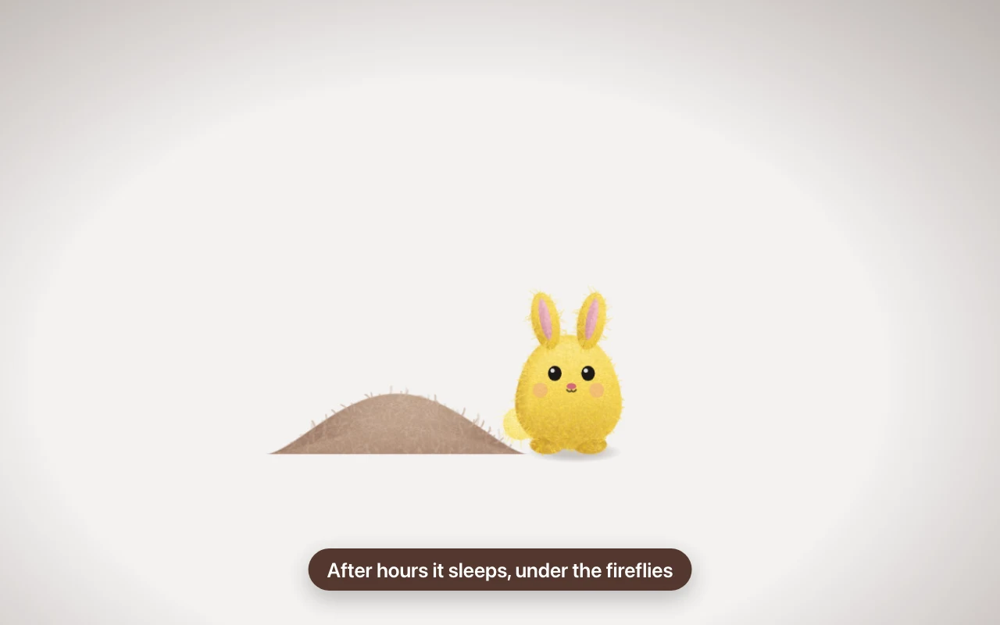
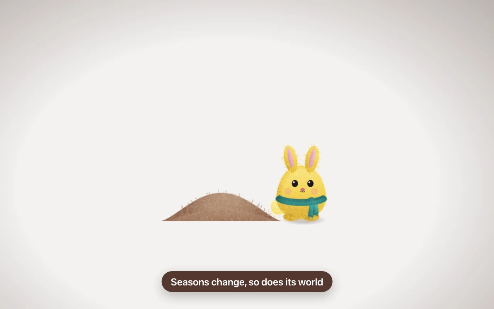
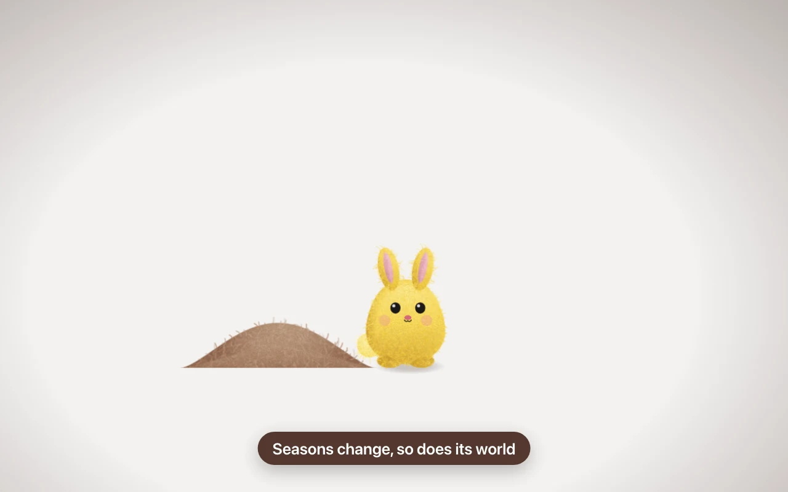
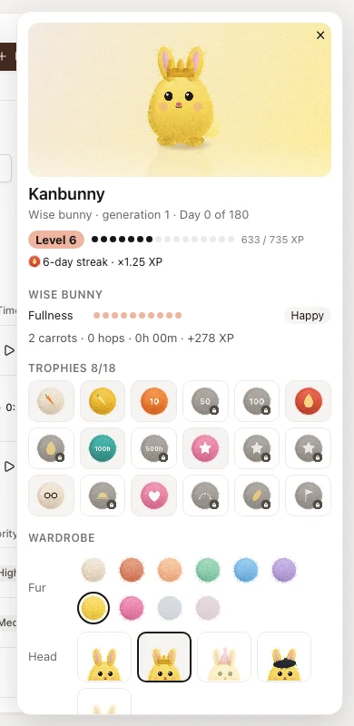
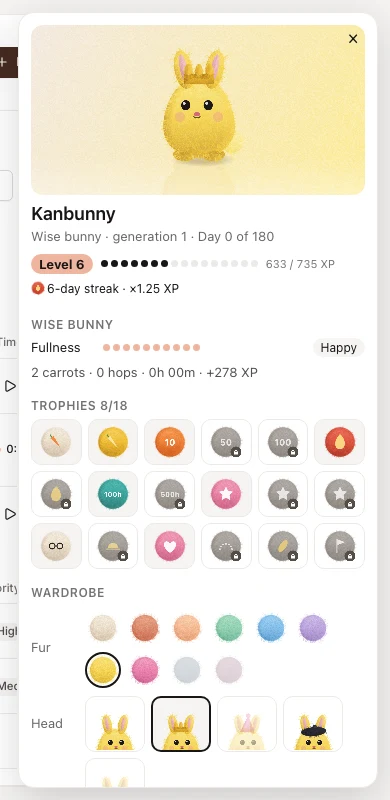

<h1 align="center">Kanbunny</h1>

<i>A desk bunny for inkledger</i>

  

  <a href="kanbunny.mp4"><b>Watch the video</b></a> ·
  <a href="kanbunny.pdf"><b>Read the overview (PDF)</b></a> ·
  <a href="../../README.md#add-on-modules">Back to inkledger</a>

Kanbunny is an [add-on module](../../README.md#add-on-modules) for inkledger. A felt bunny lives in a small burrow on the bottom edge of your work: it takes no room and moves nothing, comes out when something happens, then goes back in.

## What it does

- **Lives with your work.** Close a ticket and it eats a carrot (a golden one for high-priority tickets). Log time and it jumps, dropping crumbs where it lands, more the longer you worked, with hearts from two hours; a short log is just a hop. Stop a timer and it stretches. Move a card on the Board and it hops. Reach your daily goal and it celebrates.
- **Grows with you.** It hatches from an egg and grows with the hours you log: kit, bunny, wise bunny. It gets hungry when tickets stay open, sleeps after hours, and has a planned, finite life: after a full life a new egg carries the family on.
- **Levels, streaks, trophies.** Carrots, hops, hours and goals give XP; a streak multiplies it, and one day off a week is forgiven. 18 trophies to collect.
- **Wardrobe and fur colours.** Hats, glasses, scarves and more, plus collectible fur dyes, earned with levels and trophies.
- **Seasons.** Snow in winter, petals in spring, sunglasses in summer, leaves in autumn.
- **Its own panel.** Click the bunny: a side panel slides in, with no backdrop, so your page stays usable. Level, streak, mood, trophy case, wardrobe, a weekly diary to export as an image, and the family album.
- **Never in the way.** It reads the page under it and opens its burrow only where it does not cover text, controls or charts; if the page moves under it, it digs in and comes up somewhere free. Near the pointer it fades. On a phone it stands on the tab bar, and the tips of its ears stay out as a handle to tap.

## Screenshots

| | |
|---|---|
|  |  |
|  |  |
|  |  |
|  |  |
|  |  |

## Install

1. **Request a licence.** In inkledger, open **Settings → Store** and press **Request licence** next to Kanbunny. Kanbunny is in free release.
2. **Wait for the approval.** You can close the panel: once the request is approved, inkledger installs and activates the module by itself.
3. **Say hello.** Look at the bottom edge of the panel: an egg is waiting.

Good to know:

- It runs inside your own inkledger: no account, no tracking, nothing leaves your server.
- The licence is shared by everyone on your inkledger server and activated on up to three of your servers; it is renewed in the background every 90 days (a server that never reaches the internet is activated with an offline code from Settings → Store).
- Manage it from its status badge in **Settings → Store** (uninstall, remove the licence, reinstall); a switch there turns all modules off.
- It respects the system's reduced-motion setting.
