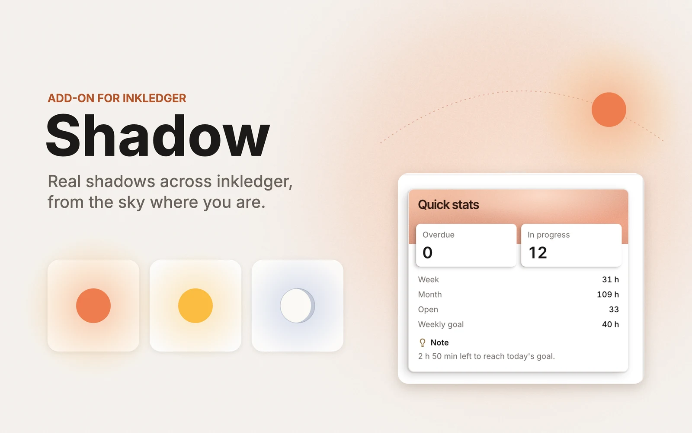
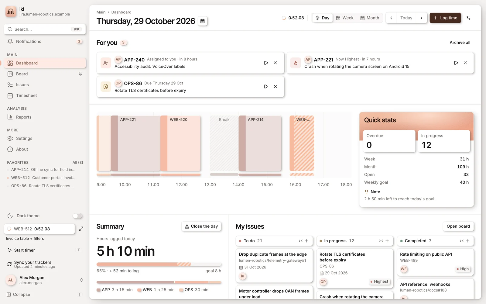
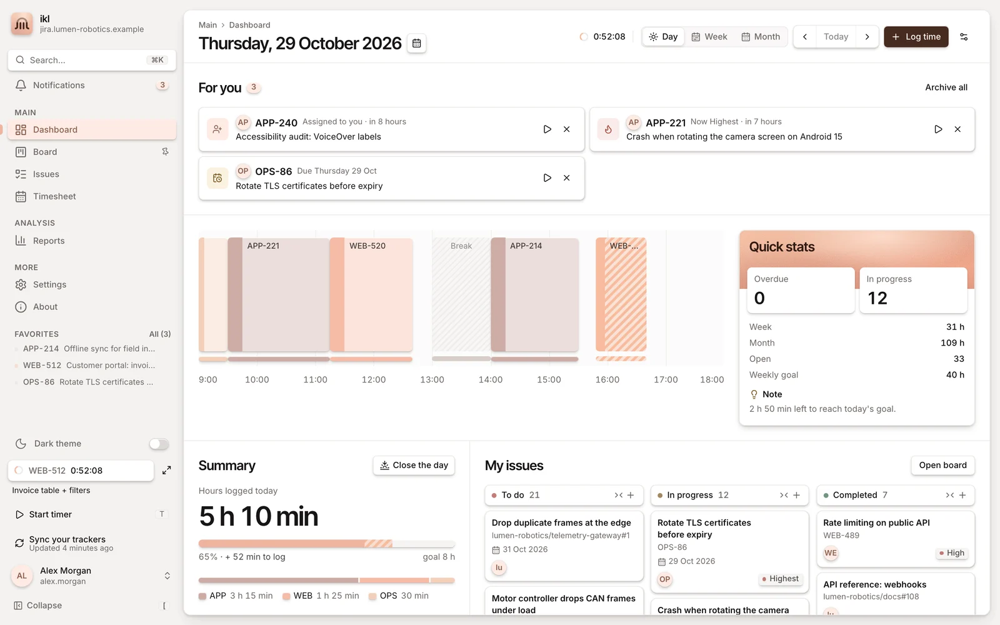
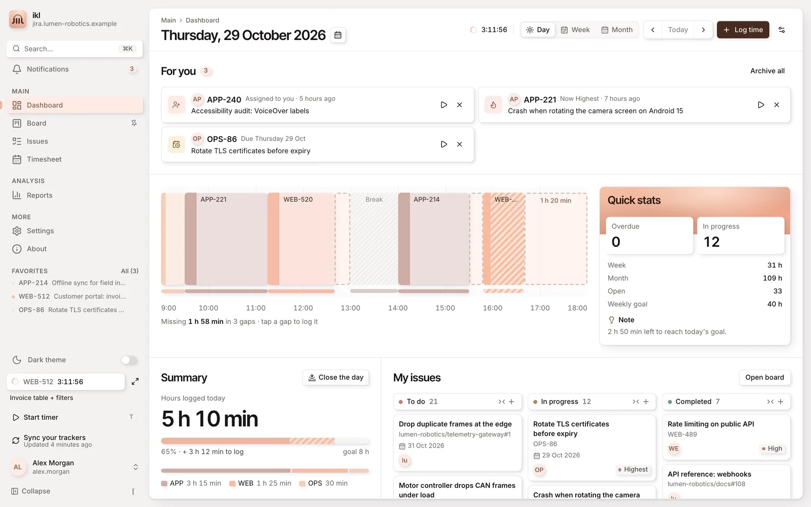
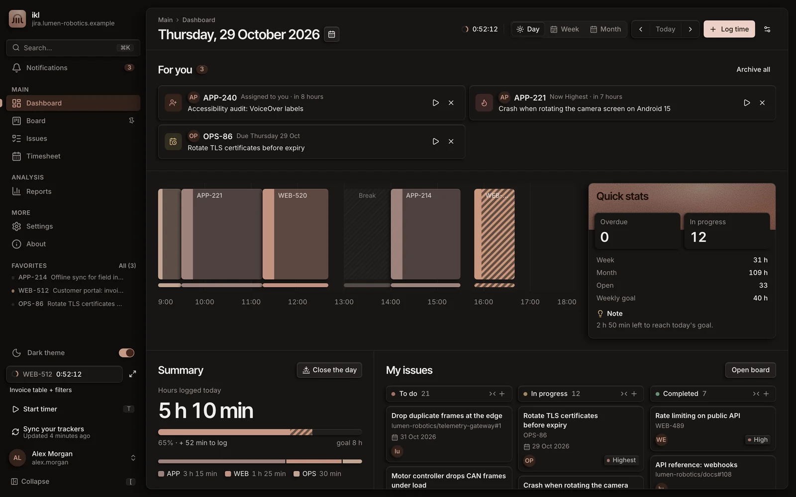

<h1 align="center">Shadow</h1>

<i>Real shadows across inkledger, from the sky where you are</i>

  

  <a href="#screenshots"><b>Screenshots</b></a> ·
  <a href="../../README.md#add-on-modules">Back to inkledger</a>

Shadow is an [add-on module](../../README.md#add-on-modules) for inkledger.

  

Every surface of the interface (buttons, chips, cards, menus, dialogs, the main panel)
stands at its own height and casts a shadow away from the light:

- **The sun.** Long and soft at dawn and sunset, short and sharp at noon. Morning light comes
  from the east: the left in the northern hemisphere, the right in the southern (the screen
  faces the equator).
- **The moon.** Faint, cool shadows by moonlight, as strong as its phase. A night with neither
  sun nor moon up has no shadows at all, and the main panel dims a little
  (**Night on the Dashboard** in Settings → Appearance turns the dimming off).
- **Clouds.** With the weather on, an overcast sky softens and lightens every shadow.

The place is estimated from your browser's time zone.

## Screenshots

One Thursday in Rome (29 October), the same dashboard:

| | |
|---|---|
|  |  |
|  |  |
|  | |

## Install

1. **Request a licence.** In inkledger, open **Settings → Store** and press **Request licence** next to Shadow. Shadow is in free release.
2. **Wait for the approval.** Once the request is approved, inkledger installs and activates the module by itself.
3. **Look around.** Every page now has the light of the hour where you are.

## How it behaves

- It works on every page. Changing page restarts nothing: the light is already where it is.
- Nothing animates. The light moves on its own, continuously: shadows fade in over half an
  hour at dawn and out at dusk, in steps too small to see.
- See-through parts (the running timer's stripes, days without a goal) never cast a shadow,
  so no dark box shows through them.
- Focus rings stay as they are.
- Uninstalled or switched off, the interface is exactly as without it.

## Cost

A few CSS variables on the page, rewritten only when a change adds up to something visible
(about every five minutes on average), and one stylesheet made once. No extra layers, no
filters on large areas, no transitions or animations.

## For module authors

Which elements may take an effect is described by inkledger itself, not guessed: every
surface is marked by a typed helper (`surface()` in `src/components/app/surface.ts`), and the
catalog of kinds (outline, highest elevation, see-through, floating) reaches modules through
`host.surfaces.catalog()`. A module mounted in the `app-stage` slot lives for the whole app.
