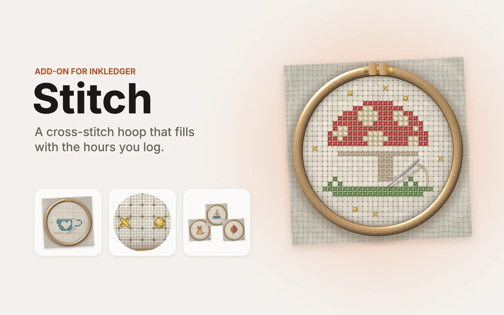
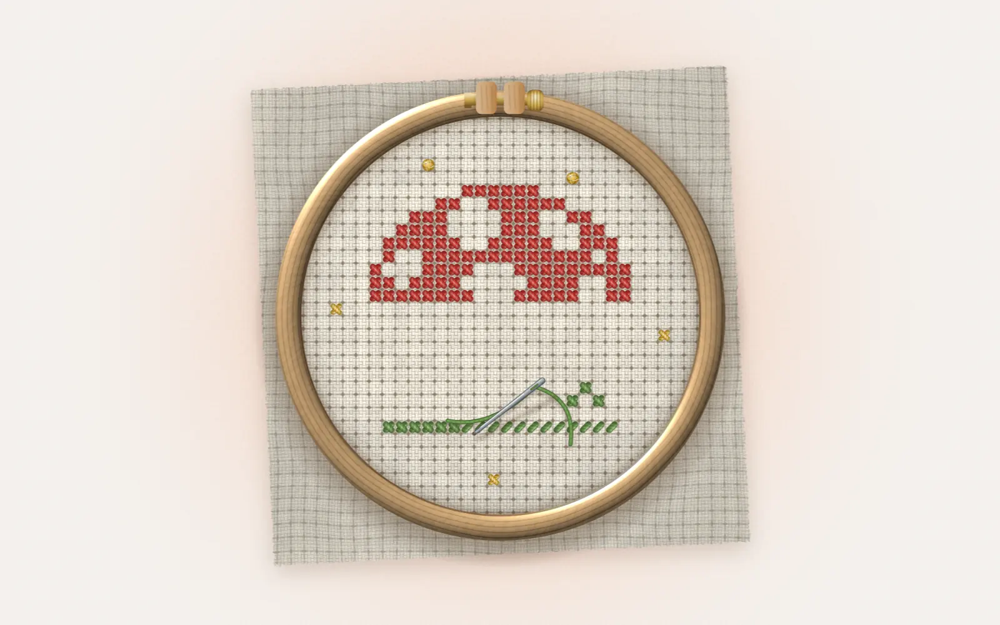
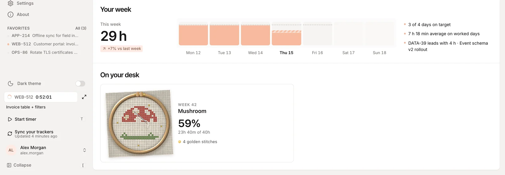
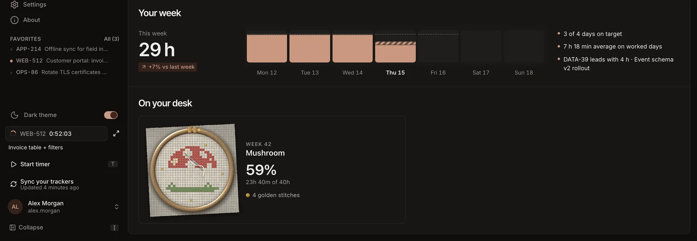
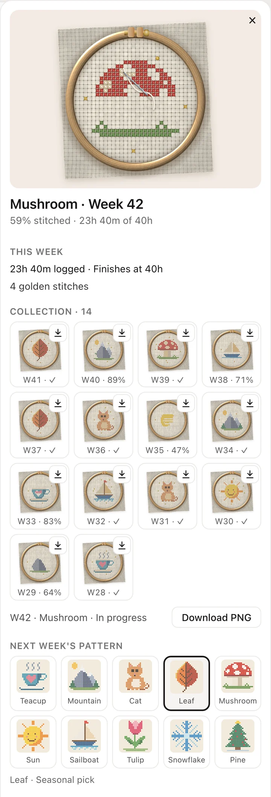
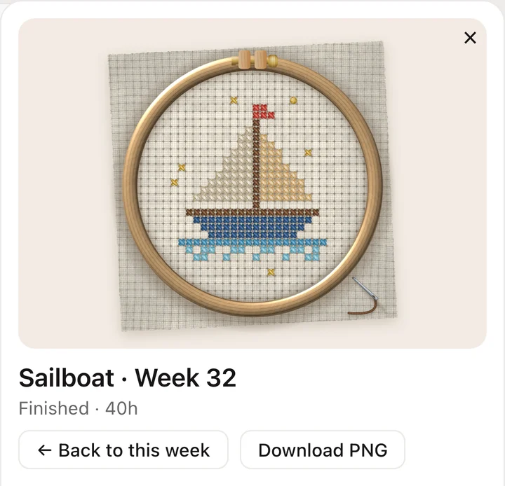
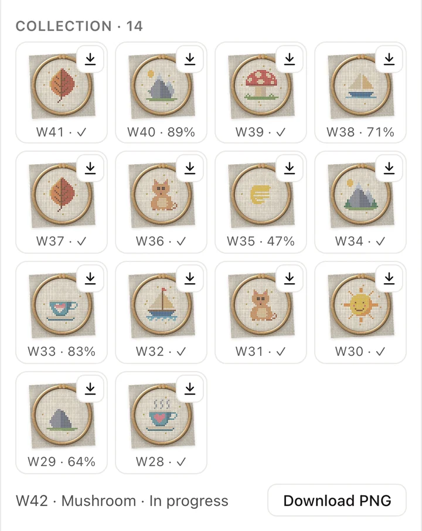
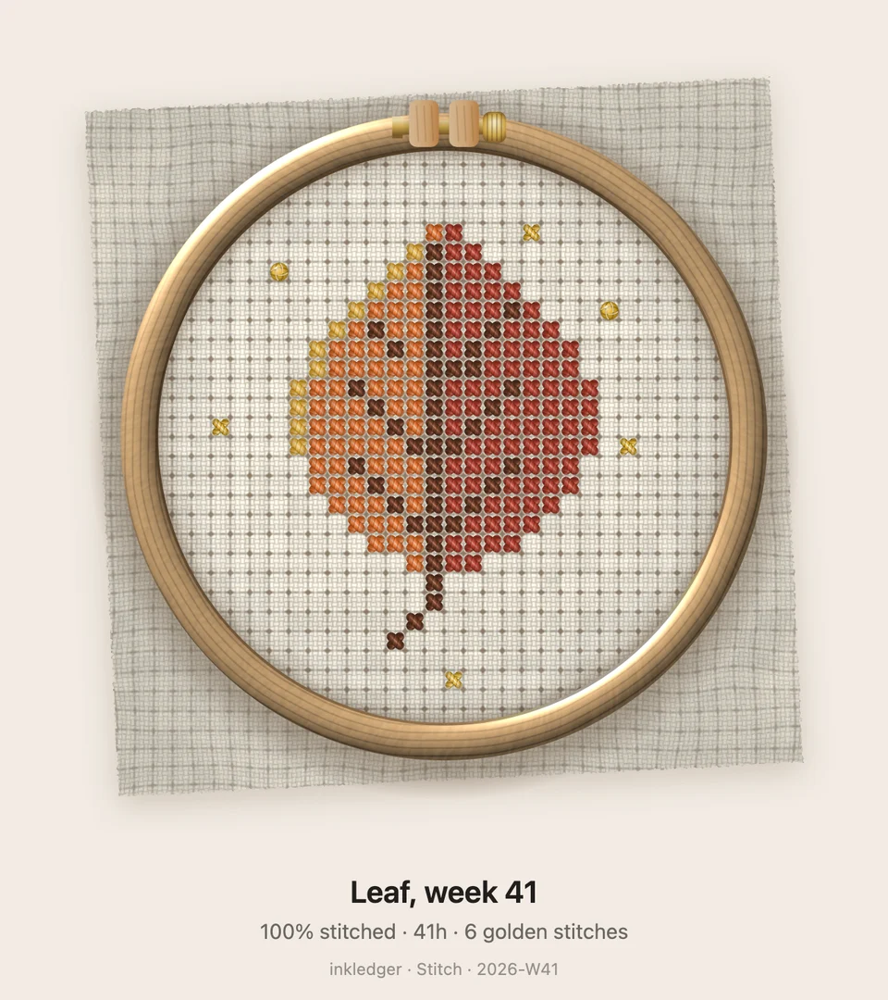
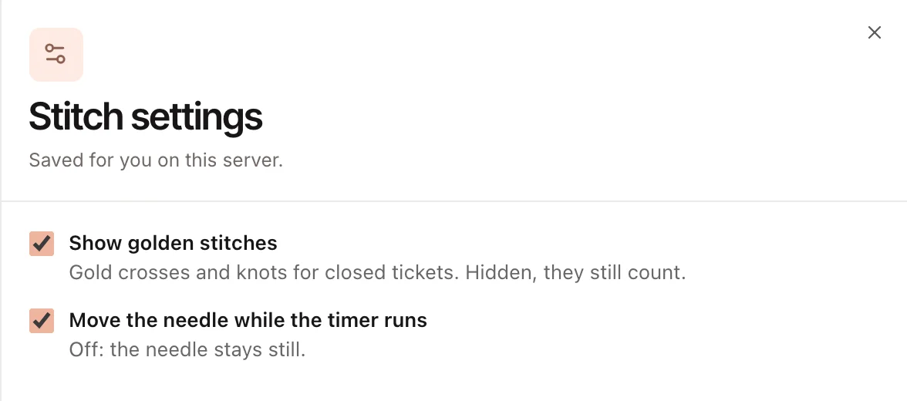

<h1 align="center">Stitch</h1>

<i>A weekly embroidery for inkledger</i>

  

  <a href="stitch.mp4"><b>Watch the video</b></a> ·
  <a href="stitch.pdf"><b>Read the overview (PDF)</b></a> ·
  <a href="../../README.md#add-on-modules">Back to inkledger</a>

Stitch is an [add-on module](../../README.md#add-on-modules) for inkledger. An embroidery hoop sits on your dashboard, and the hours you log this week stitch a cross-stitch pattern in it, one cross at a time. The pattern is finished exactly when you reach your weekly goal.

  

## What it does

- **Stitched by your hours.** A 24×24 pattern in a wooden hoop on the dashboard. Every hour you log adds stitches; the week's goal (your daily goal × 5, or 40 hours) finishes it. While a timer runs, the needle moves.
- **Gold for closed tickets.** Every ticket you close adds a gold cross around the motif; a high-priority ticket adds a French knot.
- **A collection.** On Monday the week's embroidery joins your collection, finished or not, and a new pattern starts. Pick any past week to see it again.
- **Patterns to unlock.** Three patterns to start with (teacup, mountain, cat); every finished week unlocks one more, in season first: snowflake and pine in winter, tulip in spring, sun and sailboat in summer, leaf and mushroom in autumn. Choose next week's pattern, or let it pick a seasonal one.
- **Any week as a picture.** Every week in the collection has its own download button, and this week saves too, in progress: a PNG ready to share.
- **Its own panel.** Click the hoop: a side panel with this week's progress, your collection and next week's pattern. On a phone it opens as a sheet above the tab bar. Its settings (golden stitches, the moving needle) are in its sheet in **Settings → Store**.

## Screenshots

| | |
|---|---|
|  |  |
|  |  |
|  |  |
|  | |

## Install

1. **Request a licence.** In inkledger, open **Settings → Store** and press **Request licence** next to Stitch. Stitch is in free release.
2. **Wait for the approval.** You can close the panel: once the request is approved, inkledger installs and activates the module by itself.
3. **Start stitching.** Open the dashboard: this week's hoop is under *On your desk*.

Good to know:

- It runs inside your own inkledger: no account, no tracking, nothing leaves your server.
- The licence is shared by everyone on your inkledger server and activated on up to three of your servers; it is renewed in the background every 90 days (a server that never reaches the internet is activated with an offline code from Settings → Store).
- Manage it from its status badge in **Settings → Store** (settings, uninstall, remove the licence, reinstall); a switch there turns all modules off.
- It counts the hours logged since it was installed: a week started before that fills from the day you install it.
- It respects the system's reduced-motion setting.
